# Chromium 156 / shared AROS CEF migration

Target: Chromium **156.0.8078.96**, matching CEF branch **8078**. This directory
contains reproducible prerequisites while the main AROS patch queue is migrated.
It is not a finished browser or CEF binary release. The root `PINS`, `EXPORT.json`
and patch queues still describe the retained Chromium 124 baseline.

## Native H.264/AAC and current external CDM — 2026-11-28 UTC

[Source724 and native media evidence](evidence/media729/README.md) record a complete x64 build, native H.264/AAC playback/seek/replay and PCM output, loader ABI tests for the current external CDM, and usable Widevine keys and displayed sample frames. Playback through encrypted sections and Widevine buffering/session stalls remain unresolved. ARM archive/native builds and offline H.264/AAC play/seek/replay now pass; ARM audio output and release qualification remain open. The current snapshot covers22 repositories and is not an RC.

## Native encrypted media control — 2026-11-28 UTC

[ClearKey playback and Widevine comparison](evidence/media715/README.md) records a complete native 60-second VP9/Opus encrypted sample, host-side reproduction of public Widevine license failures, and a subsequent native DevTools memory failure. Protected Widevine playback and stability remain open.

## Native video and audio — 2026-11-27 UTC

[Media cleanup and playback evidence](evidence/media707/README.md) records native x64 VP8/VP9 playback, seeking and replay, Opus audio output, and corrected renderer media-object destruction. That earlier build predates the H.264/AAC integration above; sustained protected Widevine playback remains open.

## Native DNS correction — 2026-11-27 UTC

[Resolver high-descriptor overflow fix](evidence/dns700/README.md) restores fresh browser name resolution. Native high-descriptor probes, HTTPS page loading, and the Shaka media-manifest download pass. A separate pcnet32 transmit fault remains recorded; the e1000 replacement passes fresh media-manifest download and external-CDM initialization with normal QEMU DNS.

## External Widevine initialization — 2026-11-27 UTC

[Native external CDM initialization](evidence/widevine693/README.md) now passes on x64 through LinuxSO. Discovery and mapping fixes, native build results, and the HTTPS support screenshot are published. Protected playback remains unverified; the proprietary module is not redistributed.

## Latest build and SMP refresh — 2026-11-27 UTC

[Consolidated current-master prerequisites and build evidence](evidence/master682/README.md) supersede the master632/taskstorage668 stack for upstream `28fbd1d6`. Both CEF and V8 builds and native browser packages are complete. Native x64 WebGL1/2 through Mesa Vulkan and ARM New Tab rendering pass on the preceding fixed kernels. Latest-SMP runtime, lifecycle, persistence, memory, external Widevine and release qualification remain open. No RC is published.

## Earlier source602 validation — 2026-11-27 UTC

The earlier snapshot **602** was replay-checked across all21 modified repositories. It retains585's four2 MiB superpages per10 MiB Exec allocation and adds native TLS cleanup for Blink's per-task SmallStringCache. Both full CEF archives and native603 libraries build. [Cache retirement and native regression evidence](evidence/cache602/README.md) records the exact controls and limits.

X64 run604 passes100 browser sessions,100 renderer retirements,102 child-owned zero entry/exit pairs and full host shutdown. A missing utility83 entry in the serial-only parser is explicitly reconciled using its native ledger; the original failed report remains. At cycle100, whole-guest memory is1294.33 MiB, **40.06 MiB below588**. Growth from cycles30–100 falls from95.57 to71.88 MiB. The final allocator sample contains zero allocated256 KiB cache slots. **Memory still grows; no plateau or RC is claimed.**

Native603 also passes sibling isolation606, synthetic coldboot profile persistence607, and installed icon launch on x64/ARM609/610. X64 closes and relaunches with one resident host. ARM605 shows New Tab and About AROS. These are QEMU controls on preserved matched OS inputs; ARM uses software rendering and native input.device injection.

[Current-master prerequisites and exact replay](evidence/master632/README.md) pin the complete AROS delta and required Bash configuration. The current AROS master refresh changes Task/Process ABI. Clean622 builds validate architecture flags under Bash; both frozen SDK623 builds pass, and [fresh ARM desktop637](evidence/master632/README.md#fresh-desktop-packaging-requirements) paints Wanderer and About AROS. Both V8 archives now pass. The [task-storage self-removal followup](evidence/taskstorage668/README.md) fixes a native OS lifecycle leak, with paired x64/ARM tests and zero settled loss in the fixed controls. CEF/Blink rebuilds were still in progress at this earlier checkpoint; the latest build section above records their completion. Earlier refresh611–621 artifacts are excluded after configure silently dropped Bash syntax under /bin/sh. Current-master runtime qualification, remaining memory retention, hardware GPU/CDM validation, final packaging and RC publication remain open.

[Earlier superpage evidence](evidence/superpage585/README.md), [resolver/coldboot evidence](evidence/resolver572/README.md), and [cache/WebGL evidence](evidence/cache564/README.md) retain their original build identities.

## Earlier validation status — 2026-11-20 UTC

[Current native x64 validation](evidence/native316-x64/README.md) passes
installed-icon keyboard launch, four tabs, version, closure/reopen, two-app
storage/DOM/worker isolation, and profile close/reopen persistence. Source287
and engine288 pass30 lifecycle cycles, but memory still grows205.44MiB between
cycles10 and30; memory plateau remains open. [Cold-boot profile persistence](evidence/cold317-profile/README.md) now passes for synthetic cookies and localStorage.
The snapshot at this earlier stage was421. [Renderer retirement and production configuration](evidence/retirement389/README.md) pass both native engine links, x64 two-app isolation and browser profile close/reopen. Production profiles now exclude Chromium developer field-trial experiments; rebuilt ARM acceptance remains pending. [Feature-provider lifetime and current regressions](evidence/lifetime364/README.md) pass native x64 lifecycle and two-app isolation; whole-guest memory growth remains unresolved. [Stable owner identity and profile startup](evidence/owner342/README.md) pass both native links, x64 application isolation and profile close/reopen. [Native tracing-task retirement](evidence/trace333/README.md) removes the per-cycle task growth in a ten-cycle x64 run; whole-guest memory still grows. Older results retain their build identities.

[Native credentials on fresh master](evidence/credentials307-master/README.md)
pass on x64 and ARM. Both SDKs include the generated prerequisites.
[Fresh-master ARM desktop validation](evidence/master297-arm-desktop/README.md)
passes Wanderer/About. Both330 native engine links pass. ARM341 with source338/native339 gets past the earlier directory fault but still faults before first paint: a retiring renderer remains visible as live after its channel is cleared. The retirement fix is included in source360 and both native361 links pass; full ARM browser readiness remains open.

The fresh x64 SDK also requires the [retained LinuxSO loader prerequisite](evidence/linuxso270/README.md)
used by the previous native Widevine path. It now builds against master;
end-to-end CDM validation remains pending.

The earlier [native252 lifecycle result and source267](evidence/native252-scroll267/README.md)
confirm ten sessions,23 successful child exits and complete host shutdown, with
renderer metrics backing reclaimed. The separate full-browser264 test exposes
a scroll-global assertion on multitab closure; the task-local fix passes host
and cross-object tests and is integrated in267. Fresh-master builds and native
acceptance remain underway. No RC is released. The older results below retain
their original build identities.

Native x64 candidate226 launches through the installed AROS icon, paints New Tab,
opens four tabs and chrome://version, closes, and reopens through the same
resident host. Its second session passes two500-iteration calculation,
animation, mutation, custom-element, Range and XML pages. All11 observed
renderer tasks return successfully without a native fault. The earlier217
closed-queue crash is corrected. [Screenshots, exact symbols, serial and
limits](evidence/native-browser226/README.md) are retained.

Compact232, built from the same226 source, also passes full native UI, two
browser sessions, both500-iteration stress pages and closure; all13 observed
renderer tasks return0. Its initial premature keyboard attempt is retained and
excluded from the four-tab result.

The separate compact234 ten-cycle run passes every page, full host shutdown,
and independent native FAT-ledger accounting:23 child tasks return0 and20
renderer heaps retire with none deferred. Memory acceptance remains open:
whole-guest use rises from1471.27MiB aftercycle1 to1646.43MiB aftercycle10,
with1095.54MiB remaining after host exit. This is OS-plus-resident-engine use,
not per-app RSS or evidence of engine duplication. The fresh FAT profile also
reports a heavy-ad SQLite cache I/O error; profile acceptance is still pending.
[Compact226 inputs, raw logs, native ledger, screenshots and measurements](evidence/compact226-native)
are retained. Current independent-app isolation and profile close/reopen pass in311/312; cold-profile replay passes in313.

The Wanderer drawer title corruption after closure remains under investigation.
ARM74 opens the installed browser window and About AROS, but full browser
painting remains incomplete. This does not qualify USB input or physical Pi hardware.
The complete21-repository226 source is replay-checked in
[native-shutdown226/source](evidence/native-shutdown226/source).
No RC binary release has been published. See the
[current RC gates](evidence/release500/release-candidate-gates.json).

The earlier matched191 bare-engine comparison reduced whole-guest cold-load
use from871.59 to646.89MiB. That separate experiment is not a matched
full-browser comparison; see [cold-load evidence](evidence/compact-image198/README.md).

Fresh x64 andARM SDK builds pass against upstream AROS master b6dcaeea plus
[replayable private prerequisites](evidence/native-browser226/master229-source).
The ARM production kernel, workbench and external targets pass; optional
full-build developer tests hit a retained GCC16 ICE. The x64 OS build and independent desktop boot pass.
Candidate226 still uses its original frozen SDK/runtime; no latest-master
browser rebuild is claimed.

The current directory-enumeration candidate passes native x86-64 writer158 and
clean reader159: cookies/localStorage survive a fresh OS session, case-distinct
application and profile identities stay separate, and every started child and
the host return successfully. The Chromium-local directory fix avoids the SDK's
unsafe descriptor selection path without changing the SDK. Temporary storage
tracing has been removed. The replay-checked snapshot contains all 21 modified
repositories; use its own PINS and manifest, not the historical root Chromium 124 queue.

Native AArch64 ARM58 paints the full Chrome window and local JavaScript/Wasm
worker PASS page, then returns all six native child tasks and the host. Its
reviewed screenshot includes About AROS identifying aarch64-raspi. This is QEMU
validation, not physical Raspberry Pi qualification. Intermittent ARM stalls
remain a separate deferred investigation.

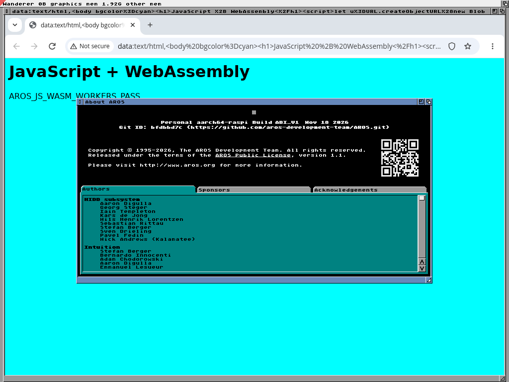

Native x86-64 memory164 completes ten browser create/render/close cycles in one
resident host: ten page checks, all 22 child returns, and host completion pass.
Memory acceptance does **not** pass: whole-guest usage grows from 1706.72 MiB
after cycle 1 to 1949.76 MiB after cycle 10, about 27.00 MiB per additional cycle,
and remains 1753.80 MiB after host exit. These are OS-plus-resident-engine totals,
not peak RSS or evidence of copied engine images. Renderer heap retirement
remains active work; successful task return alone is not memory reclamation.
See [the measured baseline](evidence/native-children/cef-memory164-analysis.json).
A one-cycle control retains 1492.41 MiB after host exit, versus 1753.80 MiB
after ten cycles; the [controlled comparison](evidence/native-children/cef-memory164-vs171-analysis.json)
records its limits and the separate child-entry fragment audit.

The private worker-ownership candidate also passes native x86-64 memory165:
all ten pages, 22 child returns and host completion succeed. Its measured
retention remains approximately 27.45 MiB per additional cycle; the ownership
fix is not a memory-reclamation fix. A separate native Exec ownership probe
passes 700 controlled checks. ARM acceptance for that candidate and runtime
validation of the subsequent isolate-cleanup candidate remain pending. These
results do not replace the validated directory158 snapshot above. See the
[165 measurements](evidence/native-children/cef-memory165-analysis.json).

Earlier native HTTP/HTTPS, multi-app DOM/cookie/worker isolation and sibling
survival evidence remains retained, including native119 and full Chrome121.
The controlled x64 lane uses one CPU. Interactive tabs/profiles/sign-in/media,
Node/Electron/Zune consumers, browser Vulkan/CDM integration, sandbox security
and broad hardware qualification remain outside the completed evidence. Exact
inputs and limitations are in [native validation](evidence/native-children/README.md).

## Earlier initialization evidence — 2026-11-18 UTC

Both architectures have produced complete CEF archives and native CEF/Blink
modules that pass linking and ELF validation. On native x86-64 AROS with two
CPUs, the public CEF library opens, reports Chromium 156 and the expected CEF
revision/API hash, and closes with return code 0. A one-CPU diagnostic control
now completes CEF initialization and a message-loop tick; teardown remains
unverified. The identical two-CPU initialization image reproduces a kernel
scheduler-list cycle. The one-core browser loads its test document (status 200), paints at 769x540,
and reaches its close callback. A profile-error dialog remains visible in this
build; full CEF teardown then fails a Viz root-frame-sink CHECK. The native
SQLite locking integration is queued for the next runtime build. No AArch64 runtime result is claimed.
See `evidence/cef156-init49-result.json` and its serial log for the precise scope.
See `evidence/cef156-browser56-result.json` for the separate painting/close result.

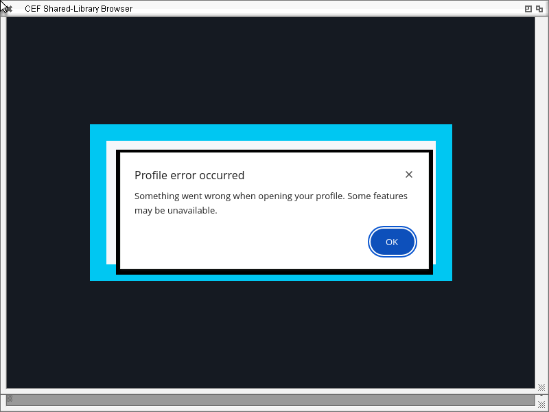

The earlier nine-byte invalid module was rejected. The host collector now
propagates child signals, checks inspection-tool failures, validates ELF output,
and avoids rescanning already included whole archives.

See `evidence/cef156-version41-result.json`, its input hashes and serial log.

Both native V8 modules include native Exec workers, a shared code arena and
shared dispatch backing with separate isolate allocation/GC spaces. The latest
controlled x86-64 two-core test passes: two applications share one resident
library, each owns two isolates, A exits before B resumes JavaScript, and both
finish with return code 0. Incremental guest RAM for B is **7,048,736 bytes**
(about 6.72 MiB), down from 560,627,664 bytes in the prior controlled test.
This is bounded V8 evidence, not full CEF/profile isolation qualification.
The original on-demand 2 MiB PartitionAlloc policy remains.

The larger 5,000-function-per-isolate stress test passes on one CPU, including
isolate replacement and both app exits. Its identical two-CPU image still
fails in the kernel; this remains an open stress qualification issue. Both
engines now use the full AROS formatter locally, fixing GC diagnostics that
previously treated a floating-point argument as a string pointer. Native stack
bounds also pass a two-core JavaScript recursion/RangeError regression.

The allocator-owner retirement fix passes 200 native rounds with Exec
workers on CPUs 0 and 1 and is integrated into both native engine builds.
Native AArch64 execution and ARM Linux ET_DYN/CDM loading remain untested; the
SDK's Linux-object mapper currently implements x86-64 only.

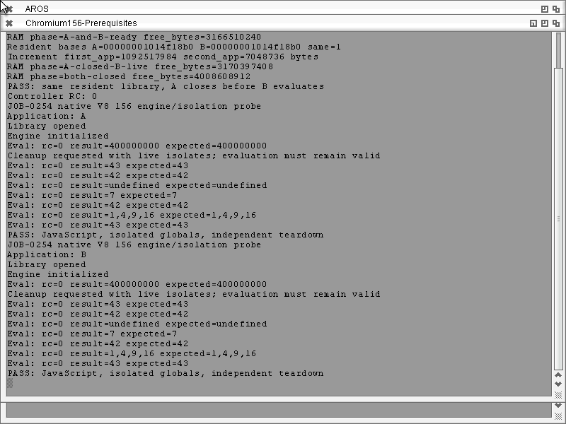

The result, native module hash and memory phases are in
`evidence/v8-memory34-result.json`; the synchronized fixture is
`evidence/v8-shared-code156-probe.c`. The companion aros-web changes include
allocator-selection synchronization and resident diagnostics that do not retain
the first application's stdio lifetime.

Desktop integration is incomplete. Native screen-lock notifications and
Workbench shortcut creation are unavailable; shortcut calls report failure.
External Vulkan buffer imports have no native handle contract, and the ANGLE
WebGPU backend has no AROS window adapter. These paths must not advertise
capabilities they cannot provide. Native Vulkan swapchain rendering remains
separately validated; browser-level Vulkan integration is pending.

Pinned inputs:

| Input | Revision |
| --- | --- |
| Chromium | `2ad9b7f5a86846e0b264090723a6a78964bb84c4` |
| CEF | `6028375a4532fb89d23b58635f5c0d3a82c93959` |
| depot_tools | `132599ebbd8d22d1b1bd5ea703a6d3bc493edd71` |
| Bundled Rust | `1edd55dcfcd573872c727fa3e086369a71661ee0` (1.100.0) |
| AROS master baseline | `10ff84d8` |

The migration preserves ordinary profiles and sign-in, ports the shared CEF ABI
to 156, and targets native Vulkan plus the existing Widevine loading model.
Full engine builds, multiple-app/profile isolation, lifecycle, graphics and CDM
runtime validation are still required. No performance or conformance claim is
made by publishing these prerequisites.

## Native SQLite path and locking integration

The candidate VFS resolves assigns and Unix-form volume names through DOS locks:
`T:Cookies` and `/T/Cookies` identify the same native file. For a new database,
it resolves the existing parent and appends the filename with `AddPart`.

SQLite's POSIX record locks fail on this SDK. The native candidate instead uses
Exec semaphores and DOS `SameLock` identity in a versioned, data-only registry
shared between engine modules. It implements shared readers, a reserved writer,
pending-writer exclusion, exclusive ownership, downgrade and orderly close.
Per-database records are freed on last close; one small registry remains until
reboot and holds no engine code pointers. Other SQLite ports must adopt this
locking contract before concurrently opening the same database. Abrupt task
termination recovery remains unqualified.

The one-core native fixture passes create/close/reopen/readback, undersized path
buffers, concurrent readers, competing writers, release/reacquire, and two
separately compiled helpers sharing the registry. Both helpers cross-compile
for AArch64. See `evidence/native-sqlite59-result.json` and
`tests/build-native-sqlite-aros.py`. The fixture omits ICU collation only;
production keeps ICU. Full CEF profile integration is still under test.

Native pc-x86_64 page protection now uses the existing dynamic `KrnMapGlobal`
API for identity-mapped allocator memory, preserving on-demand 2 MiB superpages.
A 48-region native protect/restore fixture passes, beyond the legacy protection
API's fixed 32 split-table limit. Other architectures retain their protection
backend. This is a Chromium-local change, with no SDK mmap or kernel patch.

## Chromium-local memory mapping compatibility

The AROS SDK must not implement `mmap` for this port. Keep compatibility in
Chromium's AROS file/cache adapters and its bundled dependency patches, gated
to AROS. XNNPACK selects its heap fallback and TensorFlow Lite uses explicit
file reads. These fallbacks are not general POSIX shared mappings and must not
advertise shared visibility, demand paging or page-discard support that they
cannot provide. Shared-memory IPC continues to use the native Chromium AROS
shared-memory adapter. Preserve the allocator's on-demand 2 MiB policy.

This is a port constraint, not a request to add SDK headers, libc symbols or
an SDK-wide mmap emulation layer.

The TensorFlow Lite fallback passes a host regression harness selecting the
AROS code path: injected short reads, EINTR and premature EOF; preserved file
position; invalid offsets/descriptors; retry after failure; and rejection of
resize/discard operations. Its source also cross-compiles with both native
AROS GCC 16 toolchains. The same regression harness then passed on native
AROS x86-64 SMP in the owned QEMU/KVM VM, with return code 0. AArch64 runtime
validation is still pending.
The harness and retained output are in `evidence/tflite-aros-file-snapshot-test.*`.

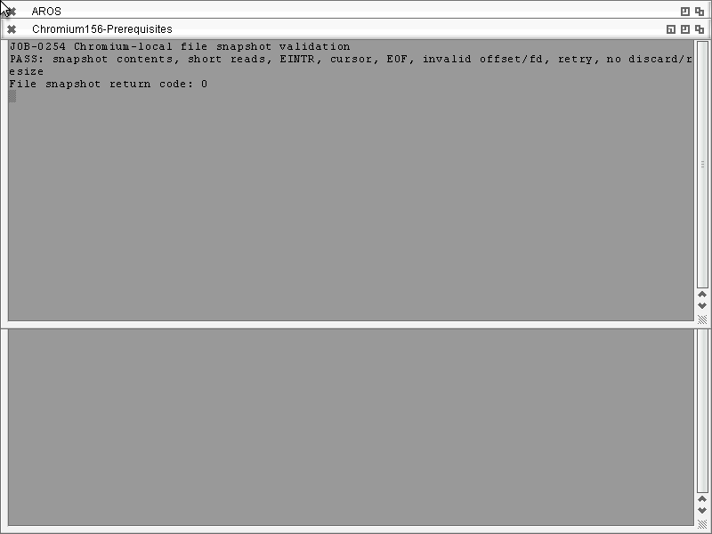

## Native V8 156 library

The V8 archive and `aros-web` native `v8.library` build with GCC 16.2.0 and
Binutils 2.47. The library links GN's Rust archive closure (including Temporal)
and native Rust std glue. Its standalone archive disables the allocator shim
so the existing library allocation-ownership interface remains authoritative.
See `aros-web/build/v8-native156.args.gn` for the validated build configuration.

The native x86-64 QEMU probe passes with two overlapping application processes
using one resident library. Each creates two isolates with independent globals,
requests cleanup while isolates remain live, and continues evaluating JavaScript.
Application A exits while B remains active; both return 0. This is bounded V8
lifecycle evidence, not CEF rendering or persisted profile isolation proof.
Library hash and scope are recorded in `evidence/v8-native156-validation.json`.

A stricter, synchronized memory/lifecycle test subsequently **failed** against
that same library. Two additional isolates in app B reduced guest free RAM by
1,666,875,072 bytes (about 1.55 GiB). App B then hit `IsOnCentralStack()` after
app A closed. The earlier timing-based pass does not establish general multi-app
lifetime correctness or acceptable memory use. See
`evidence/v8-memory28-result.json` for measured phases and limitations, and
`evidence/v8-memory156-probe.c` for the controlled reproducer.

Completion requires one resident engine implementation and shared engine
resources across apps, separate app/profile/isolate state, survival of the
first application's exit, and measured incremental RAM for additional apps.
Library packaging alone is insufficient. Native worker integration, direct
Exec stack-bound queries and opt-in `AROS_V8_MEMORY_TRACE` allocation diagnostics
are in the current snapshot; the controlled V8 runtime test above covers their basic shared lifecycle.
The AROS-only non-compressed V8 heap now holds a reference to a shared code
arena instead of reserving one arena per isolate. Its page allocator is engine
owned, and the last isolate releases the arena. The modified heap cross-compiles
with actual GN flags on x86-64 and AArch64. The controlled two-core warmed-code
run now passes with shared dispatch backing; the measured result and larger
stress qualification limits are recorded in the current status above.

Use two cores for current native qualification; higher-core AROS scheduler
issues remain separate follow-up work.


## Native Rust prerequisite

`rust/std-aros.patch` adapts the existing AROS standard library port to the
Rust sources shipped with this Chromium revision. `rust/files.json` verifies
both original and patched source hashes. The original AROS Rust source is from
commit `d0630b7` in the existing rust-aros port; native glue is adapted from the
previous x86-64 port, replacing fixed pthread storage and hand-declared native
structures with current SDK types. Randomness uses master `getentropy()`;
there is no clock-based PRNG fallback.

Run with an owned Chromium checkout and a built native AROS SDK:

```sh
python3 upgrade/156/rust/build-probe.py \
  --chromium /path/to/chromium/src \
  --sdk /path/to/native/AROS/Developer \
  --cc /path/to/x86_64-aros-gcc \
  --out /path/to/private/probe-build
```

The script validates the Rust compiler revision and source hashes, applies the
patch when needed, builds the standard library and optimized probe, compiles
native glue with warnings treated as errors, and links `Rust156Probe`. It uses
a source-derived Cargo target directory because Cargo can otherwise reuse stale
build-std artifacts after changes to the bundled standard-library sources.

Validation so far: clean patch application reproduces all 36 source hashes;
standard-library/probe cross-compilation and native SDK linking pass. The
probe also passed on a freshly built native AROS master x86-64 SMP image in
QEMU/KVM (2 CPUs, 4 GiB RAM), returning 0 after allocation, worker-thread
creation/join, mutex sharing and current-directory lookup. It does not certify networking,
process spawning or full standard-library behavior; those inherited adapters
still require native coverage and integration review before release.


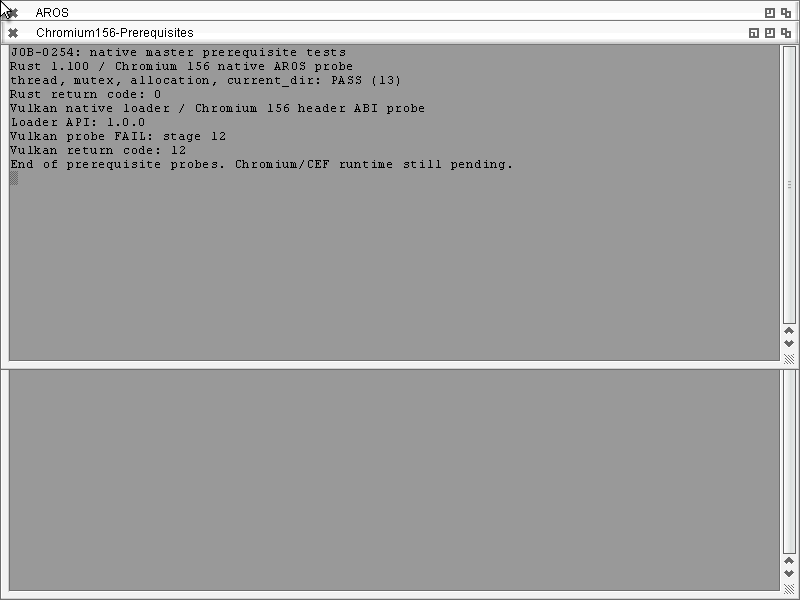

The same run reports Vulkan loader API 1.0.0 and stops at the probe's 1.1
requirement (return code 12). This GCC-built image has no selected Vulkan ICD;
the subsequent run below adds native LLVM/lavapipe. This is a recorded failure,
not Vulkan rendering validation. The screenshot is a prerequisite test, not a
Chromium window.

## Native Vulkan capability result

After building LLVM 20.1.0 and lavapipe against the same native master SDK,
`vulkan.library` reports Vulkan **1.4.354**, one CPU device named
`llvmpipe (LLVM 20.1.0, 256 bits)`, **165 device extensions**, and
`VK_KHR_swapchain` revision 70. Physical-device queries report robust buffer
access, geometry shaders and shaderInt64. Instance creation/destruction and
lookup of the native AROS surface entry point pass; probe return code is 0.


This verifies driver discovery and capability queries in native QEMU/KVM. It
does not by itself prove rendering. The presentation test below exercises
the native surface and swapchain. Hardware GPU acceleration, Chromium/CEF
graphics integration and Vulkan conformance remain unverified.
The initial no-driver result above is retained as diagnostic evidence.

## Native Vulkan rendering

Master's `vktorusknot` test now runs with `SWAPCHAIN` on the same native
QEMU/KVM system. Its first-frame readback check passes, a 384 x 384 swapchain
with two images is created, and 300 frames are presented with return code 0.
A longer 6000-frame run supplied the visible rendering capture below.

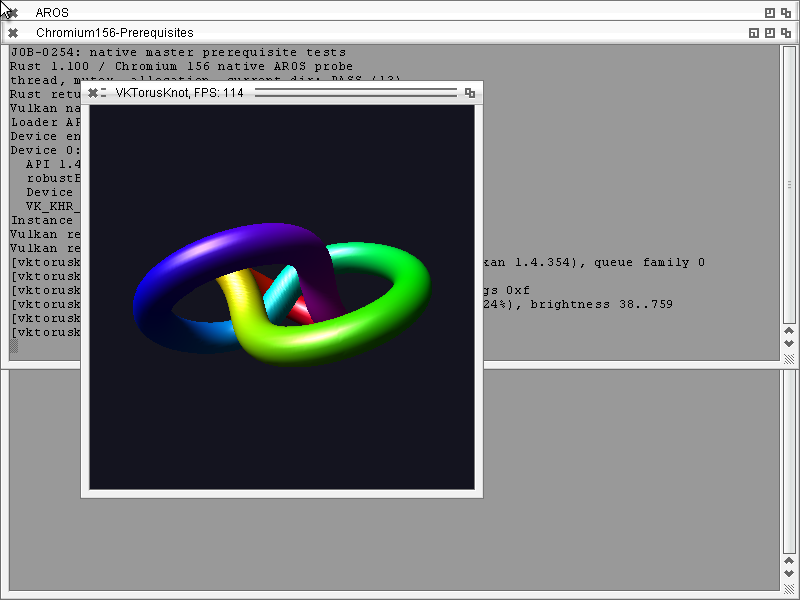

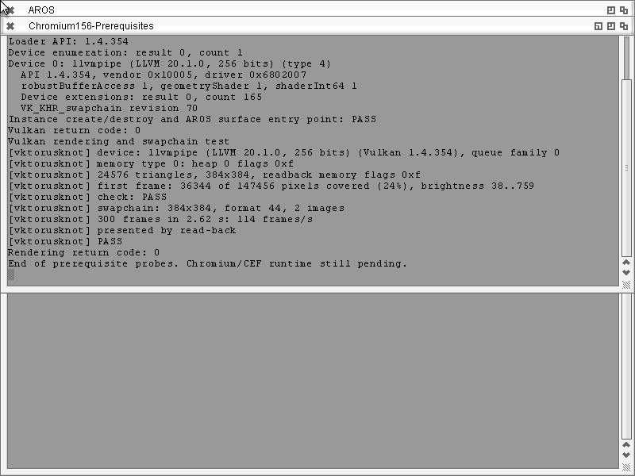

`aros/mesa-gcc-llvm-archives.patch` enables Mesa's LLVM draw and tessellator
archives when a GCC build explicitly selects target LLVM. Apply against the
pinned AROS master baseline, build LLVM, then build lavapipe with
`make -j8 OPT_LLVM=20.1.0 hidd-lavapipe` and the test with
`make -j8 OPT_LLVM=20.1.0 test-vulkan-torusknot`. This is software Vulkan
rendering in native AROS, not a Chromium/CEF window or hardware GPU test.

## AArch64 / Raspberry Pi work in progress

Native AArch64 is now in the delivery scope alongside x86-64. The private
Chromium 156 build graph generates 35,074 targets for `target_cpu="arm64"`.
The Rust standard library builds successfully through that GN graph using
`rust/aarch64-unknown-aros.json`; an extracted object is verified as ELF64,
little-endian, AArch64 (see `evidence/arm64-rust-std-object.txt`).

This is compile evidence only. Fresh GCC 16.2.0 toolchains for x86-64 and
AArch64 now compile and link a C++23 probe using the current AROS patches.
A complete Raspberry Pi system build remains pending. CEF linking, Raspberry Pi boot,
application isolation, graphics and media runtime remain unverified.
The full Chromium 156 patch queues are still being migrated; the root queues
remain the older baseline and must not be mistaken for a completed 156 port.

## Toolchain migration

The upgrade now targets GCC 16.2.0. The fresh GCC 15.2 AArch64 build exposed
a missing unwinder configuration already fixed in AROS's GCC 16.2 patch by
[upstream commit b44eff7b](https://github.com/aros-development-team/AROS/commit/b44eff7b4ae7c383c420bef120886c2cacac9371).
The commit explains both the required helpers and the intentionally omitted
runtime components. Chromium also requires `std::ranges::starts_with`,
which is present in the GCC 16.2 sources but absent from the copied GCC 15
headers used for the initial migration.

Both new toolchains pass compile and link probes covering `std::uint64_t`
and `std::ranges::starts_with`. Both Chromium GN graphs now select GCC 16.2;
the temporary Chromium-local `cstdint` overlay has been removed. The full
x86-64 CEF rebuild is running. The x86-64 C++23 probe also passes in native AROS under QEMU (exit 0);
AArch64 execution and full CEF linking remain unverified.

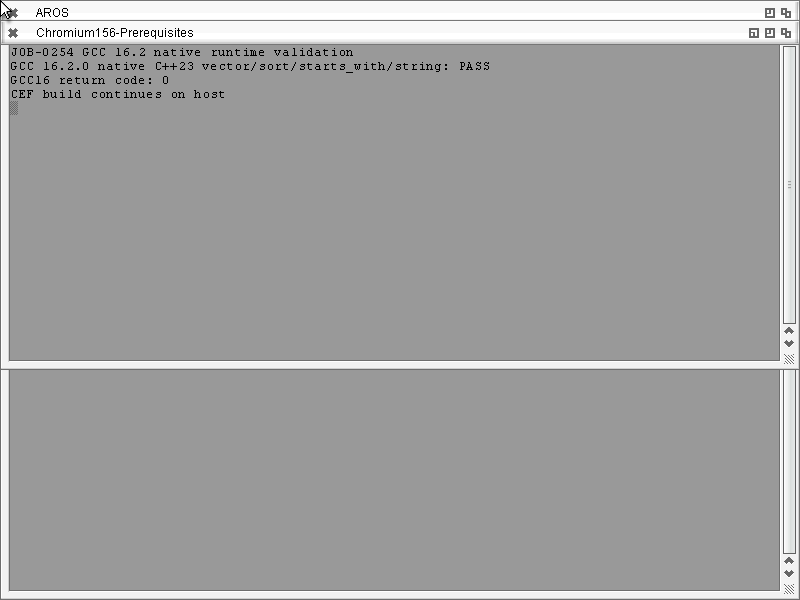 See `evidence/toolchain-migration.json` for provenance.


## Assembler and ARM runtime update

Both private toolchains now use the Binutils 2.47 AROS patch already carried by master. The previous x86 Binutils 2.32 assembler rejected Chromium's AVX-512 FP16 kernels; the same kernel now compiles. ARM baseline architecture flags precede the per-codec flags, so SVE kernels retain their instruction selection without raising the baseline for the whole browser.

`aros/aarch64-gcc16-runtime-helpers.patch` adds GCC's standard `t-aarch64` runtime definitions to the existing AROS configuration. This supplies the ZA-state helper required by GCC 16's exception unwinder. The upstream detector defaults SME support to false when the OS has no detection API; this does not enable SME in AROS. Both architectures compile/link the C++23 runtime probe, and x86-64 runs it successfully on native AROS. See `evidence/binutils247-validation.json` for the warning-policy detail and artifact hashes.


## Native Dawn event wait validation

The AROS event implementation uses one-shot shared state with a mutex and condition variable, without depending on POSIX pollable descriptors. Its tests pass both on the host and native x86-64 AROS: pre-signaling, zero/finite timeout, eight concurrent waiters, and 1,000 signal/wait races. This validates the event primitive, not a complete WebGPU or CEF runtime.


## Credentials library on master

`aros/credentials-library-master.patch` carries the native library port at
`9b448f77`; apply `aros/credentials-entropy-resource.patch` (`51de4166`)
after it to use master's `entropy.resource` on both architectures. Both library
cross-builds pass, and native x86-64 replay passes with that entropy source.
The port preserves existing login key encoding, separates named
collections, rejects truncated names, respects read-only and explicit locks,
and refuses to replace a corrupt or unreadable master seed. The native test
uses only synthetic data in a disposable RAM directory and returns 0.
See `evidence/credentials-validation.json` for scope and remaining work;
Chromium 156's new key-provider integration is still pending.

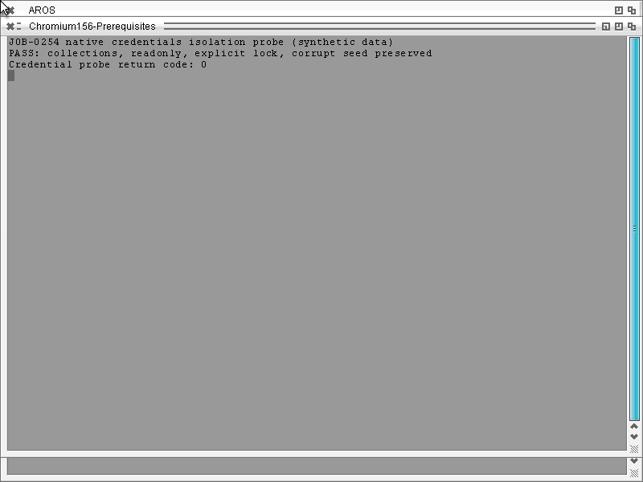

## Full CEF build configurations in progress

`build/cef-x64.args.gn` and `build/cef-arm64.args.gn` record the current full
archive build settings. Replace the compiler and SDK paths with your own GCC
16.2/native SDK installations. These are compilation baselines with the ANGLE
null backend; they do not claim completed CEF rendering, Vulkan integration, or
optimization qualification. Native standalone Vulkan rendering is covered by
separate evidence above. Sign-in, extensions, PDF and Widevine build targets
remain enabled. NSS client/server toggles are explicit so host helper builds
and the aggregate NSS setting agree; the native AROS trust path uses the Chrome
Root Store. User-installed trust roots still require separate integration.

The PDFium read-only mapping consumer now uses an owned file snapshot on AROS.
Enterprise scanning uses Chromium's existing native `MemoryMappedFile` backend.
These changes do not add an SDK mmap API. Full consumer runtime tests remain
pending.


## Native multicore migration in progress

The direct AROS primitive probe runs on CPUs 0 and 1 using native process
creation, CPU masks, Exec semaphores, task-local storage, and child-exit
notification. It makes no pthread calls. V8 worker creation and joining now
use the draft native `aros-native-task` backend, including per-worker CRT
initialization. Both integration files compile with the actual x86-64 and
AArch64 V8 build flags; complete library rebuilds and engine runtime tests
are pending. V8 TLS and synchronization still use existing adapters.

The uninstrumented native adapter test passes on two CPUs: ten lifecycle
cycles, 80 workers and ten cross-task joiners, with C++ allocation and TLS
checks. A trace-enabled four-core single-cycle test passes, but uninstrumented
four-core testing stalls. Captures show a circular running-task list and a
separate recursive lock through `Wait`, `KrnSpinLock` and `SetTaskPri`.
The latter matches the earlier SMP investigation's removal95 result.
Removing spinlock priority adjustment in a private diagnostic kernel did not
make the four-core lifecycle test pass; source and build were restored to the
baseline. No kernel fix or broad multicore qualification is claimed.
See `evidence/native-smp-relay-comparison.json` for scope and distinctions.


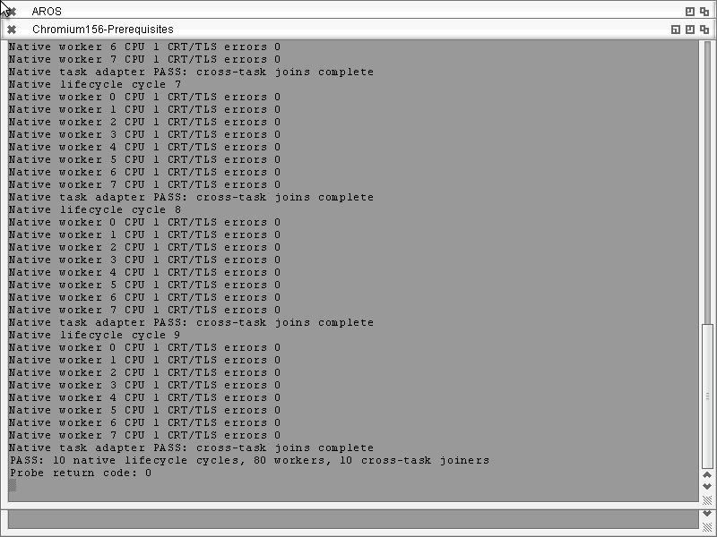

Chromium's own `PlatformThread` creation, join, detach and handle comparison
now have native AROS paths too. The backend passes a two-core probe with
80 joined workers, ten cross-task joiners and 80 detached workers. The test
waits for detached tasks to disappear from the native task list, and checks
C++ allocations and compiler TLS. Integration files compile with the actual
Chromium flags for both architectures. Full engine runtime remains pending;
existing TLS/synchronization and third-party pthread adapters remain.

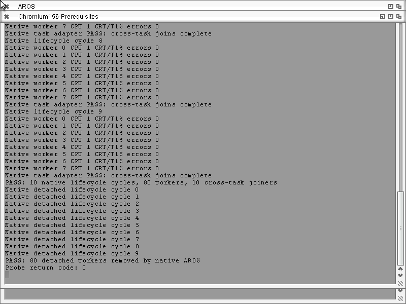

The AArch64 standalone V8 archive and 124 MiB native `v8.library` now cross-link.
`evidence/v8-arm64-build.json` records the exact library hash. AArch64 runtime and
full CEF runtime remain pending; the built V8 artifact still uses the previous
thread backend.


## Native CEF high-address allocator correction

CEF identity opens and closes on native x86-64, but initialization exposed a
reservation metadata overflow. ISO44's hardware watchpoint caught a normal-bucket
`0xfffe` tag at table index 2546; the inherited non-pool table had only 2048
entries (4 GiB). The write damaged an Abseil TLS descriptor and caused a false
32 GiB allocation request. `evidence/reservation-corruption44.json` records the
instruction, library hash, addresses, and table dimensions.

The AROS table now covers 256 GiB, matching its existing pool membership bitmap,
and checks address/range bounds in release builds. This adds 252 KiB of static
metadata per linked allocator instance; allocation remains on-demand in 2 MiB
super pages. Offsets still describe individual reservations and retain their
16-bit tag limit. This does not reserve 256 GiB of RAM or virtual address space.

Run `python3 tests/run-reservation-offset.py /path/to/chromium/src
/path/to/chromium/src/out/aros-cef156` from this directory. The host test uses
production headers and generated AROS flags, with a fatal-check adapter for
native logging. ASan/UBSan pass high-address normal buckets, direct maps and
release tagging; an address at 256 GiB is rejected. The same test against the
old headers reports a global buffer overflow. Native CEF initialization with
the corrected library is still pending; these host results are not browser
runtime qualification.

## Native browser input and OS notification evidence (2026-11-18)

ISO63 runs native module15 (SHA-256 in `evidence/cef156-link15-elf.json`)
and the aros-web `4176f38` mouse/focus client on one x86-64 CPU. It paints
the page without the earlier profile-error dialog. A native mouse click
changes the DOM to `AROS_CLICK` and logs `AROS_INPUT_CLICK`. Closing the
window reaches the browser-closed callback, but full CEF teardown fails a
Mojo InterfaceEndpointClient sequence check. Symbolization identifies
CefRenderManager destruction from the browser AtExitManager. This remains
a failed full lifecycle test, despite the probe's earlier browser-only PASS.

ISO64 separately exercises the installed application.library notification
server: registration, display, double-click with a matching opaque token,
close callback and withdrawal all succeed. `tests/native-notification-aros.c`
is the direct native fixture; its serial prefix still says notification62.
The initial fixture used a registration name containing spaces, which the
OS API rejects; the corrected name is ChromiumNativeProbe. This is native
OS API evidence, not yet Chromium Web Notification API integration.

## Native notification and event-loop candidate

The current snapshot replaces the AROS no-service notification stub with an
application.library bridge. It preserves Chromium's permission checks and
feature switches. Each accepted notification gets an opaque token mapped to
its originating profile, notification ID and origin; click and close messages
are replied before dispatch to Chromium. Profile teardown withdraws its
notifications. Missing library or port initialization retains message-center
fallback. The server cannot enumerate displayed notifications or distinguish
timeout from user dismissal, so synchronization is reported unsupported and
close is conservatively reported as not user initiated. Native action buttons
and notification image export are not implemented by this candidate.

Exec message-port watches now join the native pump's Wait/WaitSelect signals,
with registration generations protecting callback removal/replacement. Ozone
uses them for IDCMP and presentation messages instead of its 8 ms polling
timer. AROS CEF releases its renderer manager at renderer message-loop
destruction, before later browser-side AtExit cleanup. These source changes
are under native integration testing; the ISO63/64 evidence above predates
the integrated bridge and does not qualify this candidate.

Native browser replays 65 and 66 (x86_64, one CPU) both painted, closed, and returned from full CEFShutdown. This closes the earlier renderer sequence-check failure for these fixtures. Replay 66 includes the final native MsgPort/Ozone watch changes, but its Web Notification permission/delivery path was not exercised. ARM module 10 passed link and ELF validation (SHA256 c25e60bb98033e7901b61f01420f681f9217845b0245f80b61e4aff8c3479341); ARM runtime remains pending. The private GCC 16 ARM kernel build requires KERNEL_ISA_CFLAGS="$(KERNEL_ISA_FLAGS) -mno-outline-atomics" to avoid unresolved out-of-line atomic helpers in the freestanding core.

## ARM startup follow-up

[Two ARM visual startup controls and current RC gaps](evidence/arm401/README.md) include screenshots, whole-guest memory measurements, completed x64 lifecycle365 results, and the outstanding retirement navigation fault.

## Production startup and shutdown follow-up

[Production results and current RC gaps](evidence/production415/README.md) include ARM Chromium with About AROS, x64 startup and profile-write evidence, and the remaining shutdown and memory work.

[Renderer isolation and retirement follow-up](evidence/retirement429/README.md) records the414 failures, verified child IPC cleanup, and421 candidate. No RC is claimed.

[Profile close/reopen recovery435](evidence/profile435/README.md) passes with the actual stored token; renderer cleanup remains incomplete.
