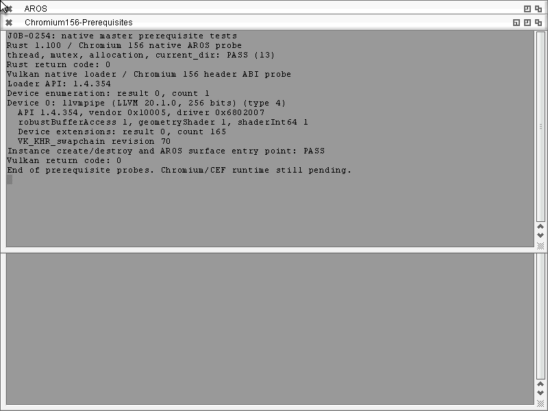

# Chromium 156 / shared AROS CEF migration

Target: Chromium **156.0.8078.96**, matching CEF branch **8078**. This directory
contains reproducible prerequisites while the main AROS patch queue is migrated.
It is not a finished browser or CEF binary release. The root `PINS`, `EXPORT.json`
and patch queues still describe the retained Chromium 124 baseline.

Pinned inputs:

| Input | Revision |
| --- | --- |
| Chromium | `2ad9b7f5a86846e0b264090723a6a78964bb84c4` |
| CEF | `6028375a4532fb89d23b58635f5c0d3a82c93959` |
| depot_tools | `132599ebbd8d22d1b1bd5ea703a6d3bc493edd71` |
| Bundled Rust | `1edd55dcfcd573872c727fa3e086369a71661ee0` (1.100.0) |
| AROS master baseline | `10ff84d8` |

The migration preserves ordinary profiles and sign-in, ports the shared CEF ABI
to 156, and targets native Vulkan plus the existing Widevine loading model.
Full engine builds, multiple-app/profile isolation, lifecycle, graphics and CDM
runtime validation are still required. No performance or conformance claim is
made by publishing these prerequisites.

## Native Rust prerequisite

`rust/std-aros.patch` adapts the existing AROS standard library port to the
Rust sources shipped with this Chromium revision. `rust/files.json` verifies
both original and patched source hashes. The original AROS Rust source is from
commit `d0630b7` in the existing rust-aros port; native glue is adapted from the
previous x86-64 port, replacing fixed pthread storage and hand-declared native
structures with current SDK types. Randomness uses master `getentropy()`;
there is no clock-based PRNG fallback.

Run with an owned Chromium checkout and a built native AROS SDK:

```sh
python3 upgrade/156/rust/build-probe.py \
  --chromium /path/to/chromium/src \
  --sdk /path/to/native/AROS/Developer \
  --cc /path/to/x86_64-aros-gcc \
  --out /path/to/private/probe-build
```

The script validates the Rust compiler revision and source hashes, applies the
patch when needed, builds the standard library and optimized probe, compiles
native glue with warnings treated as errors, and links `Rust156Probe`. It uses
a source-derived Cargo target directory because Cargo can otherwise reuse stale
build-std artifacts after changes to the bundled standard-library sources.

Validation so far: clean patch application reproduces all 36 source hashes;
standard-library/probe cross-compilation and native SDK linking pass. The
probe also passed on a freshly built native AROS master x86-64 SMP image in
QEMU/KVM (2 CPUs, 4 GiB RAM), returning 0 after allocation, worker-thread
creation/join, mutex sharing and current-directory lookup. It does not certify networking,
process spawning or full standard-library behavior; those inherited adapters
still require native coverage and integration review before release.


The same run reports Vulkan loader API 1.0.0 and stops at the probe's 1.1
requirement (return code 12). This GCC-built image has no selected Vulkan ICD;
the subsequent run below adds native LLVM/lavapipe. This is a recorded failure,
not Vulkan rendering validation. The screenshot is a prerequisite test, not a
Chromium window.

## Native Vulkan capability result

After building LLVM 20.1.0 and lavapipe against the same native master SDK,
`vulkan.library` reports Vulkan **1.4.354**, one CPU device named
`llvmpipe (LLVM 20.1.0, 256 bits)`, **165 device extensions**, and
`VK_KHR_swapchain` revision 70. Physical-device queries report robust buffer
access, geometry shaders and shaderInt64. Instance creation/destruction and
lookup of the native AROS surface entry point pass; probe return code is 0.



This verifies driver discovery and capability queries in native QEMU/KVM. It
does not yet prove surface creation, rendering/presentation, hardware GPU
acceleration, Chromium/CEF graphics integration or Vulkan conformance.
The initial no-driver result above is retained as diagnostic evidence.
