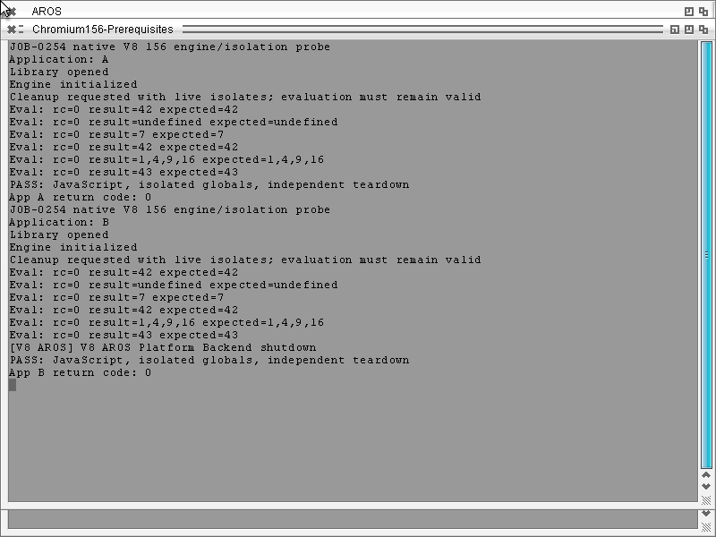
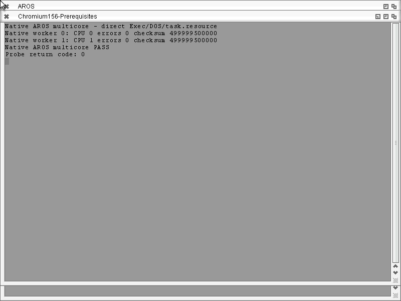

# Chromium 156 / shared AROS CEF migration

Target: Chromium **156.0.8078.96**, matching CEF branch **8078**. This directory
contains reproducible prerequisites while the main AROS patch queue is migrated.
It is not a finished browser or CEF binary release. The root `PINS`, `EXPORT.json`
and patch queues still describe the retained Chromium 124 baseline.

Pinned inputs:

| Input | Revision |
| --- | --- |
| Chromium | `2ad9b7f5a86846e0b264090723a6a78964bb84c4` |
| CEF | `6028375a4532fb89d23b58635f5c0d3a82c93959` |
| depot_tools | `132599ebbd8d22d1b1bd5ea703a6d3bc493edd71` |
| Bundled Rust | `1edd55dcfcd573872c727fa3e086369a71661ee0` (1.100.0) |
| AROS master baseline | `10ff84d8` |

The migration preserves ordinary profiles and sign-in, ports the shared CEF ABI
to 156, and targets native Vulkan plus the existing Widevine loading model.
Full engine builds, multiple-app/profile isolation, lifecycle, graphics and CDM
runtime validation are still required. No performance or conformance claim is
made by publishing these prerequisites.

## Chromium-local memory mapping compatibility

The AROS SDK must not implement `mmap` for this port. Keep compatibility in
Chromium's AROS file/cache adapters and its bundled dependency patches, gated
to AROS. XNNPACK selects its heap fallback and TensorFlow Lite uses explicit
file reads. These fallbacks are not general POSIX shared mappings and must not
advertise shared visibility, demand paging or page-discard support that they
cannot provide. Shared-memory IPC continues to use the native Chromium AROS
shared-memory adapter. Preserve the allocator's on-demand 2 MiB policy.

This is a port constraint, not a request to add SDK headers, libc symbols or
an SDK-wide mmap emulation layer.

The TensorFlow Lite fallback passes a host regression harness selecting the
AROS code path: injected short reads, EINTR and premature EOF; preserved file
position; invalid offsets/descriptors; retry after failure; and rejection of
resize/discard operations. Its source also cross-compiles with both native
AROS GCC 16 toolchains. The same regression harness then passed on native
AROS x86-64 SMP in the owned QEMU/KVM VM, with return code 0. AArch64 runtime
validation is still pending.
The harness and retained output are in `evidence/tflite-aros-file-snapshot-test.*`.


## Native V8 156 library

The V8 archive and `aros-web` native `v8.library` build with GCC 16.2.0 and
Binutils 2.47. The library links GN's Rust archive closure (including Temporal)
and native Rust std glue. Its standalone archive disables the allocator shim
so the existing library allocation-ownership interface remains authoritative.
See `aros-web/build/v8-native156.args.gn` for the validated build configuration.

The native x86-64 QEMU probe passes with two overlapping application processes
using one resident library. Each creates two isolates with independent globals,
requests cleanup while isolates remain live, and continues evaluating JavaScript.
Application A exits while B remains active; both return 0. This is bounded V8
lifecycle evidence, not CEF rendering or persisted profile isolation proof.
Library hash and scope are recorded in `evidence/v8-native156-validation.json`.



## Native Rust prerequisite

`rust/std-aros.patch` adapts the existing AROS standard library port to the
Rust sources shipped with this Chromium revision. `rust/files.json` verifies
both original and patched source hashes. The original AROS Rust source is from
commit `d0630b7` in the existing rust-aros port; native glue is adapted from the
previous x86-64 port, replacing fixed pthread storage and hand-declared native
structures with current SDK types. Randomness uses master `getentropy()`;
there is no clock-based PRNG fallback.

Run with an owned Chromium checkout and a built native AROS SDK:

```sh
python3 upgrade/156/rust/build-probe.py \
  --chromium /path/to/chromium/src \
  --sdk /path/to/native/AROS/Developer \
  --cc /path/to/x86_64-aros-gcc \
  --out /path/to/private/probe-build
```

The script validates the Rust compiler revision and source hashes, applies the
patch when needed, builds the standard library and optimized probe, compiles
native glue with warnings treated as errors, and links `Rust156Probe`. It uses
a source-derived Cargo target directory because Cargo can otherwise reuse stale
build-std artifacts after changes to the bundled standard-library sources.

Validation so far: clean patch application reproduces all 36 source hashes;
standard-library/probe cross-compilation and native SDK linking pass. The
probe also passed on a freshly built native AROS master x86-64 SMP image in
QEMU/KVM (2 CPUs, 4 GiB RAM), returning 0 after allocation, worker-thread
creation/join, mutex sharing and current-directory lookup. It does not certify networking,
process spawning or full standard-library behavior; those inherited adapters
still require native coverage and integration review before release.


The same run reports Vulkan loader API 1.0.0 and stops at the probe's 1.1
requirement (return code 12). This GCC-built image has no selected Vulkan ICD;
the subsequent run below adds native LLVM/lavapipe. This is a recorded failure,
not Vulkan rendering validation. The screenshot is a prerequisite test, not a
Chromium window.

## Native Vulkan capability result

After building LLVM 20.1.0 and lavapipe against the same native master SDK,
`vulkan.library` reports Vulkan **1.4.354**, one CPU device named
`llvmpipe (LLVM 20.1.0, 256 bits)`, **165 device extensions**, and
`VK_KHR_swapchain` revision 70. Physical-device queries report robust buffer
access, geometry shaders and shaderInt64. Instance creation/destruction and
lookup of the native AROS surface entry point pass; probe return code is 0.


This verifies driver discovery and capability queries in native QEMU/KVM. It
does not by itself prove rendering. The presentation test below exercises
the native surface and swapchain. Hardware GPU acceleration, Chromium/CEF
graphics integration and Vulkan conformance remain unverified.
The initial no-driver result above is retained as diagnostic evidence.

## Native Vulkan rendering

Master's `vktorusknot` test now runs with `SWAPCHAIN` on the same native
QEMU/KVM system. Its first-frame readback check passes, a 384 x 384 swapchain
with two images is created, and 300 frames are presented with return code 0.
A longer 6000-frame run supplied the visible rendering capture below.


`aros/mesa-gcc-llvm-archives.patch` enables Mesa's LLVM draw and tessellator
archives when a GCC build explicitly selects target LLVM. Apply against the
pinned AROS master baseline, build LLVM, then build lavapipe with
`make -j8 OPT_LLVM=20.1.0 hidd-lavapipe` and the test with
`make -j8 OPT_LLVM=20.1.0 test-vulkan-torusknot`. This is software Vulkan
rendering in native AROS, not a Chromium/CEF window or hardware GPU test.

## AArch64 / Raspberry Pi work in progress

Native AArch64 is now in the delivery scope alongside x86-64. The private
Chromium 156 build graph generates 35,074 targets for `target_cpu="arm64"`.
The Rust standard library builds successfully through that GN graph using
`rust/aarch64-unknown-aros.json`; an extracted object is verified as ELF64,
little-endian, AArch64 (see `evidence/arm64-rust-std-object.txt`).

This is compile evidence only. Fresh GCC 16.2.0 toolchains for x86-64 and
AArch64 now compile and link a C++23 probe using the current AROS patches.
A complete Raspberry Pi system build remains pending. CEF linking, Raspberry Pi boot,
application isolation, graphics and media runtime remain unverified.
The full Chromium 156 patch queues are still being migrated; the root queues
remain the older baseline and must not be mistaken for a completed 156 port.

## Toolchain migration

The upgrade now targets GCC 16.2.0. The fresh GCC 15.2 AArch64 build exposed
a missing unwinder configuration already fixed in AROS's GCC 16.2 patch by
[upstream commit b44eff7b](https://github.com/aros-development-team/AROS/commit/b44eff7b4ae7c383c420bef120886c2cacac9371).
The commit explains both the required helpers and the intentionally omitted
runtime components. Chromium also requires `std::ranges::starts_with`,
which is present in the GCC 16.2 sources but absent from the copied GCC 15
headers used for the initial migration.

Both new toolchains pass compile and link probes covering `std::uint64_t`
and `std::ranges::starts_with`. Both Chromium GN graphs now select GCC 16.2;
the temporary Chromium-local `cstdint` overlay has been removed. The full
x86-64 CEF rebuild is running. The x86-64 C++23 probe also passes in native AROS under QEMU (exit 0);
AArch64 execution and full CEF linking remain unverified.

 See `evidence/toolchain-migration.json` for provenance.


## Assembler and ARM runtime update

Both private toolchains now use the Binutils 2.47 AROS patch already carried by master. The previous x86 Binutils 2.32 assembler rejected Chromium's AVX-512 FP16 kernels; the same kernel now compiles. ARM baseline architecture flags precede the per-codec flags, so SVE kernels retain their instruction selection without raising the baseline for the whole browser.

`aros/aarch64-gcc16-runtime-helpers.patch` adds GCC's standard `t-aarch64` runtime definitions to the existing AROS configuration. This supplies the ZA-state helper required by GCC 16's exception unwinder. The upstream detector defaults SME support to false when the OS has no detection API; this does not enable SME in AROS. Both architectures compile/link the C++23 runtime probe, and x86-64 runs it successfully on native AROS. See `evidence/binutils247-validation.json` for the warning-policy detail and artifact hashes.


## Native Dawn event wait validation

The AROS event implementation uses one-shot shared state with a mutex and condition variable, without depending on POSIX pollable descriptors. Its tests pass both on the host and native x86-64 AROS: pre-signaling, zero/finite timeout, eight concurrent waiters, and 1,000 signal/wait races. This validates the event primitive, not a complete WebGPU or CEF runtime.


## Credentials library on master

`aros/credentials-library-master.patch` carries the native library port at
`9b448f77`; apply `aros/credentials-entropy-resource.patch` (`51de4166`)
after it to use master's `entropy.resource` on both architectures. Both library
cross-builds pass, and native x86-64 replay passes with that entropy source.
The port preserves existing login key encoding, separates named
collections, rejects truncated names, respects read-only and explicit locks,
and refuses to replace a corrupt or unreadable master seed. The native test
uses only synthetic data in a disposable RAM directory and returns 0.
See `evidence/credentials-validation.json` for scope and remaining work;
Chromium 156's new key-provider integration is still pending.


## Full CEF build configurations in progress

`build/cef-x64.args.gn` and `build/cef-arm64.args.gn` record the current full
archive build settings. Replace the compiler and SDK paths with your own GCC
16.2/native SDK installations. These are compilation baselines with the ANGLE
null backend; they do not claim completed CEF rendering, Vulkan integration, or
optimization qualification. Native standalone Vulkan rendering is covered by
separate evidence above. Sign-in, extensions, PDF and Widevine build targets
remain enabled. NSS client/server toggles are explicit so host helper builds
and the aggregate NSS setting agree; the native AROS trust path uses the Chrome
Root Store. User-installed trust roots still require separate integration.

The PDFium read-only mapping consumer now uses an owned file snapshot on AROS.
Enterprise scanning uses Chromium's existing native `MemoryMappedFile` backend.
These changes do not add an SDK mmap API. Full consumer runtime tests remain
pending.


## Native multicore migration in progress

The direct AROS primitive probe runs on CPUs 0 and 1 using native process
creation, CPU masks, Exec semaphores, task-local storage, and child-exit
notification. It makes no pthread calls. The draft V8 `aros-native-task` backend
is included in the snapshot but is not connected to the engine yet. It supports
native creation and cross-task joins, including per-worker CRT initialization.
A trace-enabled four-core C++ allocation/TLS/join test passes; an uninstrumented
lifecycle test stalls. The retained kernel capture shows a circular running-task
list; a subsequent controlled boot also exposed recursive task locking through
`Wait` and the kernel spinlock priority adjustment. Root-cause work and private
kernel diagnostics are ongoing. These results are not multicore qualification.



The AArch64 standalone V8 archive and 124 MiB native `v8.library` now cross-link.
`evidence/v8-arm64-build.json` records the exact library hash. AArch64 runtime and
full CEF runtime remain pending; the built V8 artifact still uses the previous
thread backend.
