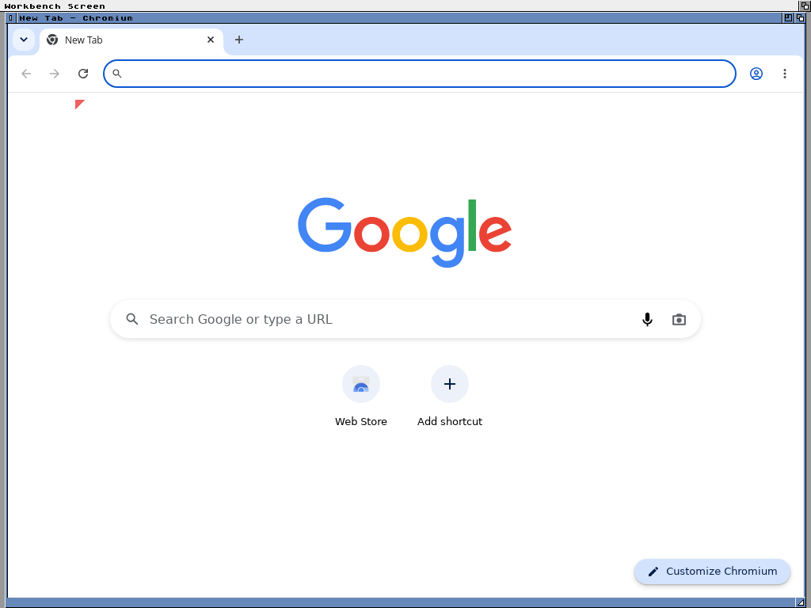

# ARM visual startup controls and current RC gaps

Two native AROS AArch64 QEMU runs,377 and387, rendered the full Chromium New Tab page using source357/native358 and the private client376 control that disables developer field-trial configuration. These are visual startup controls, not production379 acceptance or physical Raspberry Pi tests.

The settled387 whole-guest memory sample reports1584.94MiB used and393.00MiB free of1977.93MiB usable. This includes AROS and is not browser-only RSS.

The x64 source360/native361 thirty-cycle365 test completed and its independent child ledger passed. Guest memory still grew100.524MiB between cycles10 and30; no memory plateau is established. Its observer pause and recovery are recorded in the result.

ARM368 retirement stress revealed navigation proceeding without a frame host after renderer reinitialization was rejected. Exact instruction matching and frame-chain evidence are retained here. A cancellation fix is staged privately for response, error-page and no-URL-loader selection; it is not yet compiled or qualified. WebUI security checks remain intact.

Both production379 archives passed. Final native links failed with the build drive full; link intermediates have been copied and hash-verified to root storage and the retry is running. No RC or release qualification is claimed. See [current release gates](release-candidate-gates.json).
