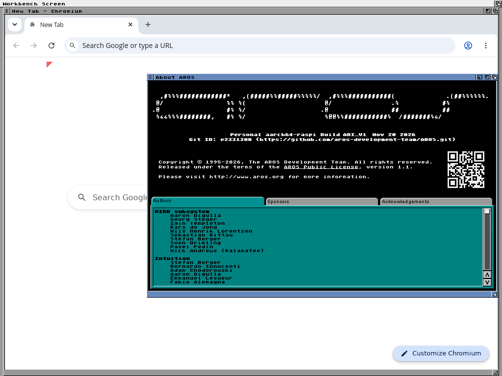

# Current native445 ARM visual startup

The native445 AArch64 engine, built from snapshot444, visibly renders Chromium
New Tab and About AROS in the private raspi4b QEMU guest448. The installed native
icon is activated through the retained input.device diagnostic. This does not
qualify physical USB input, physical Raspberry Pi hardware, ARM profile persistence,
or full browser/media/Vulkan/Widevine acceptance.

A paused read of the guest's Exec/TLSF memory counters reports1,574.64MiB used,
403.29MiB free, total1,977.93MiB. This includes the entire AROS guest and desktop;
it is not browser RSS. The raw counters and exact native/boot hashes are retained.

An earlier observation showed no browser output while the guest was in platform
SD-controller activity. It later progressed to a window and this rendered screen;
that earlier observation is not evidence of a permanent kernel deadlock. A second
fresh boot454 was started before recovery and remains separate evidence.
