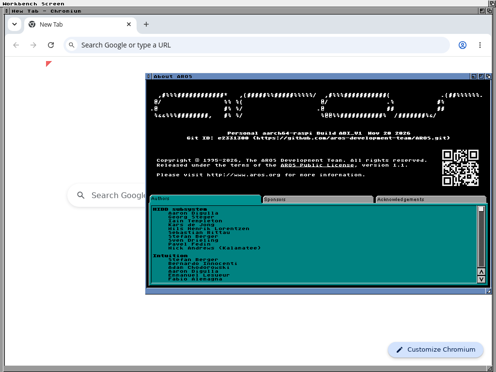

# ARM desktop/browser rendering: source468 / native469

Fresh ARM479 visibly renders Chromium New Tab and About AROS. The screenshot was inspected directly after the earlier loading pause progressed. Whole-guest Exec/TLSF counters show1572.678MiB used,405.255MiB free,1977.933MiB total. This is not browser-only RSS or a matched performance improvement.

The retained paused-QEMU read resumes the guest and verifies the expected total against the frozen ARM ABI. The private emulator still uses the documented upper-RAM DTB workaround, two-core kernel limit and null audio mode. This does not qualify physical Pi hardware, USB input, network, media/DRM, or full browser acceptance. X64 cycle474 on this same source failed in memory-instrumentation startup; see ../renderer481. The owner-ID correction source489/native490 is separate and under build/test.
