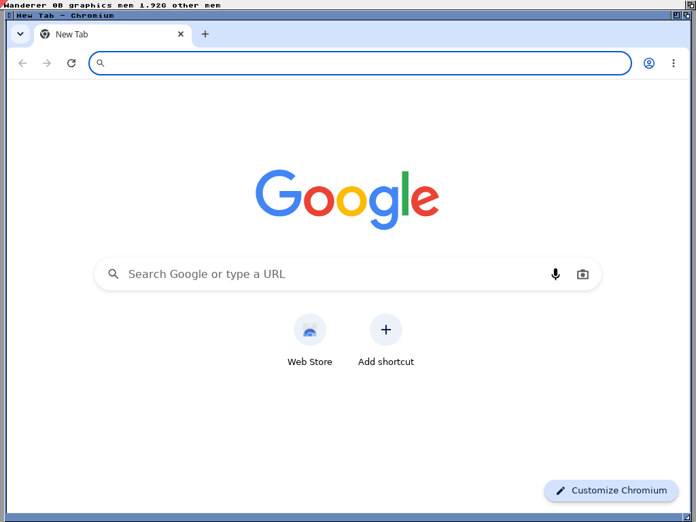

# Native cache locking and current validation

Source 564 keeps locking private to Chromium. Sandboxed GPU cache descriptors use native DOS identity and the shared SQLite semaphore registry. Writable FAT handles cannot duplicate their exclusive lock; a separate handle registry also excludes duplicated descriptors. No SDK fcntl or mmap implementation is introduced.

Native x64 probe 565 passes RAM and FAT identity, contention, duplicated-descriptor exclusion, release and reopening. Both full CEF archives compile. Native image 566 x64 run 567 passes two full Chromium sessions, WebGL 1/2 pixel readback and full host exit with zero persistent-cache errors. A read-only extraction after stopping the exact VM contains the GPU cache; a disposable copy passes SQLite quick_check with six entries. This is CPU Lavapipe, not physical RADV/NVK evidence.

The companion aros-web commit 40b921e selects Vulkan when a compatible native device exists, otherwise software rendering. ARM 560 paints the full New Tab page with this fallback; its cache 557 engine precedes 564. Native image 566 ARM validation remains pending.

Matched image 527 run 552 passes 100 pages, 100 renderer retirements and 102 native child entry/exit pairs. One interleaved parent serial print was reconciled against complete child records and the independent ledger; the exact fragment and raw hash are retained. Memory does not plateau: whole-guest use grows 154.49 MiB between cycles 30 and100 and is 1270.38 MiB after host exit. These results do not qualify a release candidate.

