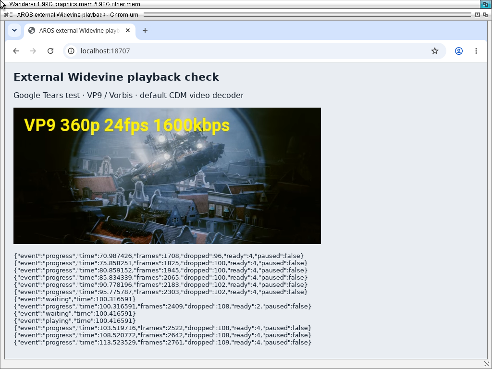

# Native graphics SMP and encrypted playback evidence

This is a tested prerequisite and an investigation record, not an RC.

## Graphics queue lifetime

Private AROS commit `13bed72e` protects the stack-based WaitTOF wait-list nodes with the native execlock resource across SMP CPUs. Disabling interrupts alone only excludes the local CPU. The interrupt traversal must finish signaling a node before its waiter removes and reuses it. The lock is released before sleeping. The change adds private library state only and preserves the public SDK ABI.

Apply [the patch](../../aros/graphics741-tof-smp.patch) after the current-master prerequisites. Rebuild `kernel-graphics` and the base boot package: replacing only a loose graphics.library does not change the library loaded from `boot/aros-base.pkg.xz`.

The matched native two-core stress uses [16 workers](../../tests/tof741-stress.c), each performing 3,000 waits and reusing its stack:

- Original graphics: stopped at 8,871 waits, zero workers complete, serial progress stopped before its deadline. This is a hang, not a completed timeout assertion.
- Fixed graphics: all 48,000 waits complete, all 16 workers done, both CPUs observed, 1,555 guest ticks.
- Both x86-64 and ARM graphics builds pass. The stress runtime comparison is x86-64 only.
- The packaged module comparison changed only graphics.library. Frozen SDK623 remains unchanged; the working SDK already contains the separately recorded master674/LinuxSO718 deltas.

## External Widevine playback

Native media738 with external CDM4.10.3112.0 confirms encrypted video input, successful CDM decode and returned frames beyond the clear lead. Run740 reached about53 seconds before the original graphics fault. Run742 with fixed graphics passed the stress test and then reached216.019948 seconds /5,497 video frames /169 dropped before a different allocator failure. Its audio capture contains2,940,036 nonzero signed16 samples; that establishes PCM generation, not physical sound output.

The new failure is a TLSF double-free trap. Exact-image symbol verification and two independent library-vector checks map the caller to the diagnostic getenv lookup in MojoDecryptorService. The AROS libc environment cache replaces storage for repeated lookups, and concurrent debug checks can race. A native GetVar stack-buffer replacement is being built separately as media746; it is not included in the older published snapshot724 and is not runtime-qualified by this record.

A fresh media738 control (745) exposed `ERR_CACHE_OPERATION_NOT_SUPPORTED` on some media requests in the original Shaka demo. Its localhost harness subsequently played encrypted video past100 seconds. Cache handling and sustained stability remain open. The screenshot is this bounded control, not proof of a completed film or release qualification.

Full guest dumps, process profiles and the proprietary CDM remain private. No keys, license responses or decrypted memory are published.
