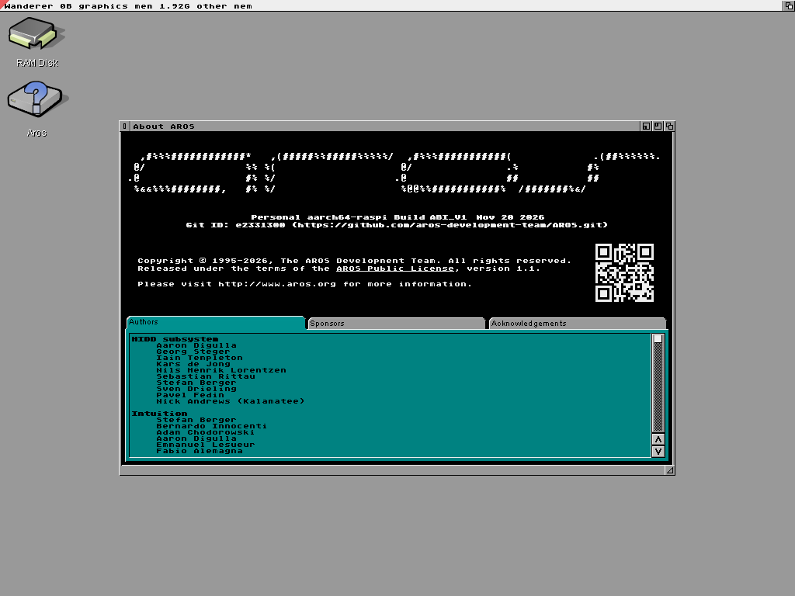

# Fresh-master ARM desktop validation

The private AArch64 AROS image boots Wanderer and About AROS in QEMU. This
validates the fresh desktop prerequisite, not the pending Chromium 288 build.
No RC binary release is implied.

Two native `AvailMem` samples, 30 seconds apart, are identical: 11.944 MiB used,
1965.989 MiB free, and 1977.933 MiB total managed memory. These are desktop-only
Exec accounting values. They exclude physical reservations and are not browser
memory use or host RSS. QEMU has 2 GiB configured; the retained diagnostic
adjustment advertises its upper RAM range to the guest.

The OS checkout is `4565772181852b838c67dac94186d7788585f64f`, based on upstream
master `b6dcaeeaa2724bbe4f6d9510c1ada4b8f69789fb` plus the retained private two-core
ARM limit and LinuxSO prerequisite. About was built at its parent `e2331300`;
the later LinuxSO change does not alter ARM boot code. The boot artifact hashes
are in `arm286-boot-result.json`.

The minimal build initially omitted startup resources and desktop libraries.
Targets 291, 292 and 295 install them explicitly; all passed. The first 278 boot
failure is retained. A copied 293 prelaunch helper referenced the retired 278
VM and refused before any guest memory write; the corrected helper verified
its own RAM adjustment before the VM started. The current desktop and serial
memory samples pass. These are native AROS results under QEMU, not physical
Raspberry Pi or USB-input qualification.

Current Chromium source remains snapshot 287. Builds 288, client builds 289,
and native browser/profile/memory acceptance remain in progress. See the
[RC gates](release-candidate-gates.json) for unresolved release criteria.
