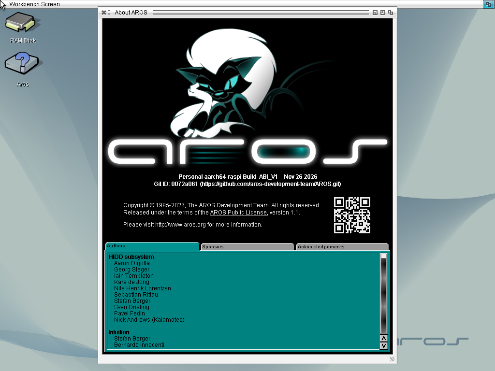

# Current-master AROS prerequisites

This is the complete private AROS delta for Chromium 156/CEF8078 against upstream **ca69713ae7f4d0c8de632f9552e74b7b59c58140**. Applying it reproduces tree **2f696ea69bc20965ca1f91413d25e598be3fb468**, corresponding to private commit **0072a0613f224ce91aaad46e2aaf351b45c0b706**. The patch was replayed into an independent index and its tree compared exactly.

Apply `aros-prerequisites.patch` once to that clean upstream commit. Do not stack the older master229, credentials, LinuxSO or other historical prerequisite patches on top. This consolidated delta already includes them and the retained ARM boot and loader prerequisites. The separate Chromium snapshot and matching aros-web source are still required.

## Configure and ABI requirements

Invoke configure explicitly with `/bin/bash` and export `CONFIG_SHELL=/bin/bash` and `SHELL=/bin/bash`. Pass `SHELL=/bin/bash` to make as well. The pinned upstream configure contains Bash append assignments: invoking it through `/bin/sh` can return success while losing architecture flags. A successful configure exit code alone is insufficient.

Verify the generated x86 flags include `-m32 -march=i486`, x86-64 flags include `-m64 -mcmodel=large`, and AArch64 flags include `-mcmodel=large` and the supported `-mno-outline-atomics` feature. Fresh622 configuration validates these settings before compilation.

The upstream Task/Process layout changed. Rebuild the SDK, engines, libraries, native applications and drivers together; do not overlay old native modules into the new OS. The attached compile-derived ABI measurements show the exact old/current sizes and offsets for both architectures.

The ARM test build uses `AROS_BOOT_CPU_LIMIT=2`; its QEMU RAM setup is a separate harness setting. No scheduler fix or physical Raspberry Pi qualification is implied.

## Validation boundary

This publication is a source prerequisite and exact replay result, not an RC binary release. Both fresh SDKs and stock desktop builds pass; the ARM production boot package passes. [Native ARM desktop637](desktop637/desktop637-result.json) now visibly paints Wanderer and About AROS at the pinned revision. The fresh x64 LLVM20.1/Lavapipe driver also builds and links successfully. [Native x64 desktop639](desktop639/desktop639-result.json) visibly paints Wanderer and About AROS on two QEMU CPUs, and the synthetic credentials isolation probe passes. Full CEF/V8 rebuilds are in progress; matched browser runtime qualification remains pending. Earlier native603 browser controls use their retained matching OS and do not qualify this newer ABI.

LinuxSO is retained for the prior x86-64 Widevine path. Its presence is not proof of CDM playback or an ARM Linux-object loader. Chromium-local memory allocation remains in the Chromium snapshot; no general SDK mmap implementation is introduced here.

## Fresh desktop packaging requirements

The architecture `workbench` target is only a subset. Build the stock `workbench-complete` target for the desktop, startup scripts, fonts and other runtime files. In this build the separately linked `aros-web` tree also contributes optional ConsoleNG targets, whose independent core prerequisites are outside this Chromium baseline. The stock desktop pass temporarily adds `ignoredir aros-web` to the build-local `mmake.config`, regenerates its MetaMake cache, then restores the exact configuration and regenerates the cache before the explicit shared-engine targets. No source exclusions are committed.

Also build **compiler-stdcio**, **compiler-posixc**, and **kernel-debug**. The SDK and Workbench aggregates alone did not install stdcio.library or posixc.library. A controlled fresh ARM image without those two modules booted to its startup script but displayed black; adding the newly built modules to the same boot/image baseline produced the desktop below. This was a packaging failure, not an established scheduler or graphics defect. The final runtime-module build changed zero files in the frozen ARM SDK.

Before freezing the engine SDK, run `workbench-libs-cef-public-includes` and `workbench-libs-cef-blink-public-includes` before the corresponding `-linklib` targets, and build `workbench-libs-v8-linklib`. A direct fresh Blink import-library build otherwise lacks its public header.

For the FAT test image, the host copy tool rejects the reserved filename AUX. Retain the stock mountlist as S:AUX-Mountlist and copy it to DEVS:DOSDrivers/AUX in the native Startup-Sequence. This is an image-building workaround. The fresh Pi device tree routes diagnostics to the second QEMU serial channel, so capture both UARTs.

This is QEMU desktop evidence with the retained two-core cap, upper-RAM device-tree adjustment and disabled hardware audio modes. It does not qualify Chromium on this ABI, physical Raspberry Pi hardware, USB input or hardware GPU acceleration. The preceding black-screen controls and their serial output remain beside the accepted result.

## Fresh x64 desktop and boot packaging

The x64 runtime-module build also changes zero files in its frozen SDK. The native credentials probe passes collection isolation, readonly behavior, explicit locking and corrupt-seed preservation using synthetic data in a private RAM directory. Whole-guest used memory before About AROS and Chromium launch is 33,936,705 bytes (32.36 MiB); this is a desktop baseline, not browser memory usage.

For the private BIOS ISO, use the fresh build's `bin/linux-x86_64/tools/grub-mkrescue` with its `tools/lib/grub/i386-pc` module directory. The staged runtime module directory lacks `modinfo.sh`. The generated test configuration must explicitly load `xzio` before reading the compressed bootstrap and packages; retain the stock `all_video` setup. Without `xzio`, this test reports no Multiboot header, while the same live GRUB command succeeds after loading that module. The decompressed bootstrap has its valid Multiboot2 header at offset 128. This is test-image packaging, not a kernel source change.

This is native x64 QEMU desktop and credentials evidence at private AROS revision 0072a061. It does not qualify the rebuilt Chromium engine, physical GPUs or a release candidate.
