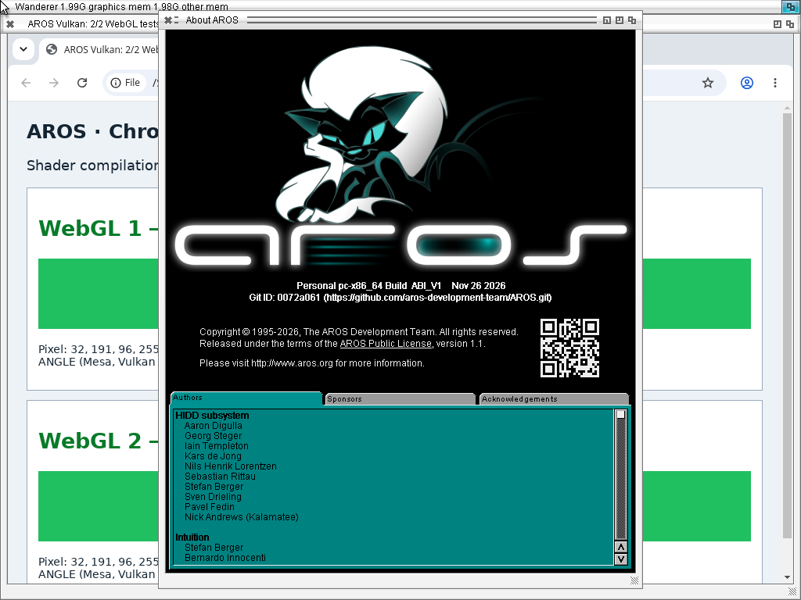
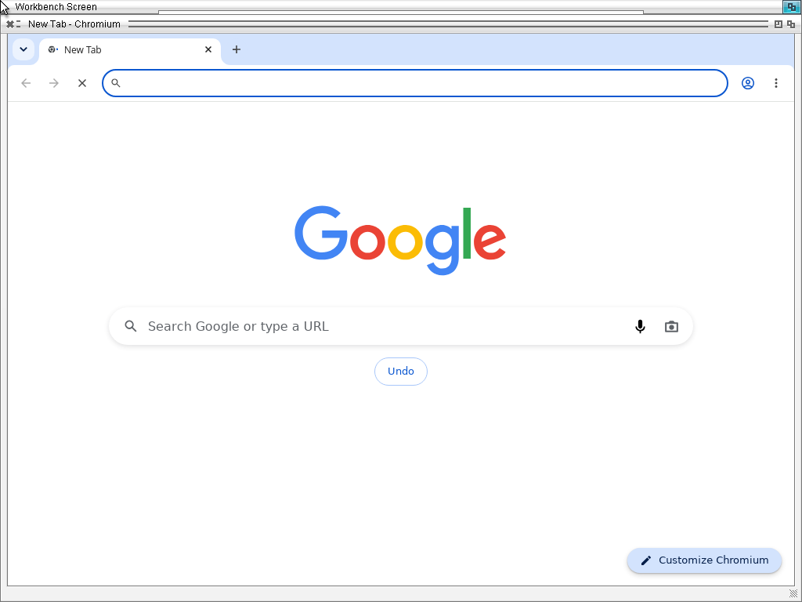

# Current SMP baseline and completed engine builds

The consolidated prerequisite patch applies to upstream AROS `28fbd1d6afa22c50db3b24de90eaa9325e5bcfc2` and replays exactly to private merge `119239593ad42813dc3c0ce6918371b8fe184df4`. `replay.json` records both tree hashes and the patch SHA256. Use this patch on that upstream base instead of stacking the historical master632 and taskstorage668 patches.

Both architecture builds passed SDK, kernel, boot, workbench, debug support and four new SMP test targets. ARM production boot packaging also passed. Task and Process sizes and offsets remain equal to frozen SDK623 on both architectures. This is build and ABI evidence; the latest SMP runtime qualification is separate and remains in progress. The x64 IRQ-affinity test reports failure moving PIT IRQ0 to CPU1; it is not a complete SMP pass.

Full Chromium/CEF624 and V8 archives, native625 shared libraries and clients, resources649, and SDK631 examples now build on both architectures. The retained screenshots show native625: x64 WebGL1 and WebGL2 using ANGLE Vulkan with Mesa26.2.7 Lavapipe/LLVM20.1, and ARM rendering Chromium New Tab. These screenshots use the earlier fixed658/663 kernels, not latest674. They are QEMU evidence, not physical RADV/NVK or Raspberry Pi validation.

ARM installation must expose the built `boot/raspi-smp/Libs/debug.library` at `Libs/debug.library`, alongside stdcio.library and posixc.library. Missing debug.library v2 prevented v8.library from opening; exposing the exact already-built module restored browser startup.

RC remains pending current-baseline lifecycle/profile/memory qualification, ARM graphics qualification and final packaging. Widevine uses an external CDM through the native x64 LinuxSO loader; discovery and protected playback are still being qualified. No proprietary CDM is included here. Sign-in runtime and physical GPU validation are not established by these results.
