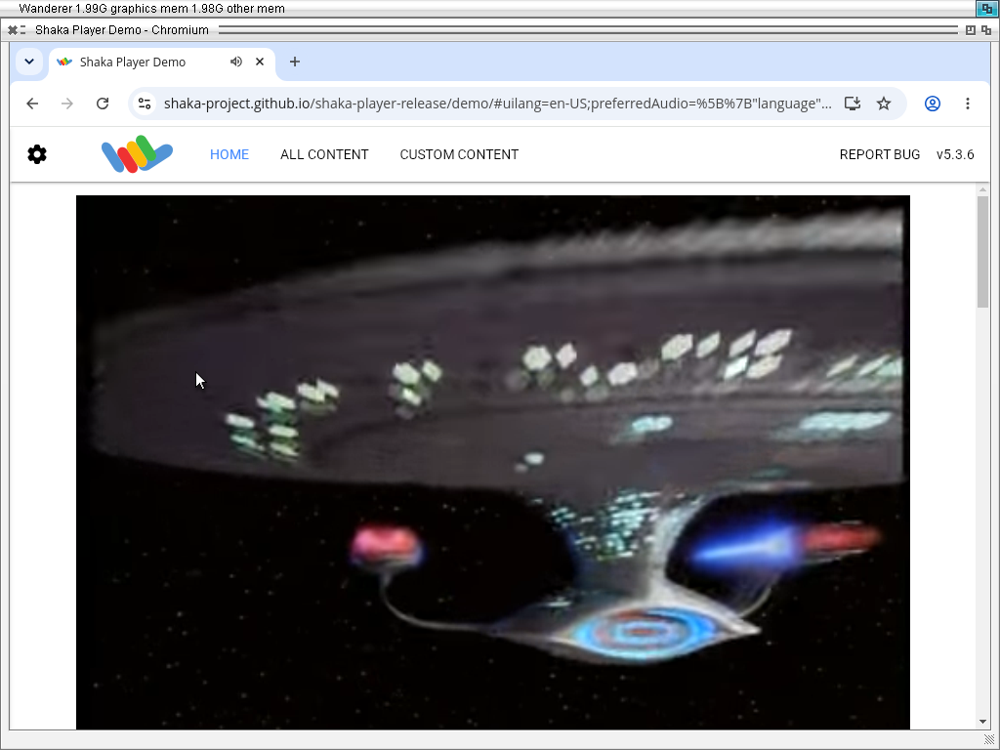

# Native encrypted media control

Native x64 AROS Chromium156, media703 engine SHA256 `d2f3f1d71a263fa90c65cc201fa7f5c5635cc8a1353926c9ba886c18e49951a7`, two CPUs and4GiB RAM:

- Official Shaka Angel One ClearKey sample completes60.001 seconds, with a usable test key and MediaKeys attached.
- VP9/Opus at480x360:1504 decoded frames,272 dropped,0 corrupted; completion100%.
- The sample uses the publisher's public ClearKey test configuration. This does **not** qualify Widevine.

`native-result.json` retains the exact native player counters. Dropped frames mean this is functional evidence, not a performance qualification.

## Widevine comparison

The external CDM initializes and issues license requests. Public Angel One and Google's ExoPlayer Tears VP9 samples both fail with Shaka6007. Independent host Edge controls also receive HTTP400, including the Tears URL with its documented provider/video query parameters. The shared failure does not identify the server-side cause or establish AROS protected playback. No license payloads or proprietary CDM binary are published.

Primary fixture definitions: [Shaka demo assets](https://github.com/shaka-project/shaka-player/blob/main/demo/common/assets.js) and [Google ExoPlayer samples](https://github.com/google/ExoPlayer/blob/release-v2/demos/main/src/main/assets/media.exolist.json).

## Later failure retained

After completed playback, collecting stats in native DevTools produced an explicit `DataCloneError` reporting out of memory. It was followed by `MemoryDumpManager::GetOrCreateBgTaskRunnerLocked` failing its thread-start CHECK, then additional process faults. The guest dump and full serial were retained privately, and the failed guest was retired. A fresh8GiB memory control is running. This evidence is **not** a stability or RC pass.

H264/AAC full integrations remain in progress on x64 and ARM; the isolated FFmpeg archives compile on both architectures. Neither those codecs nor ARM media playback are qualified by this test.
