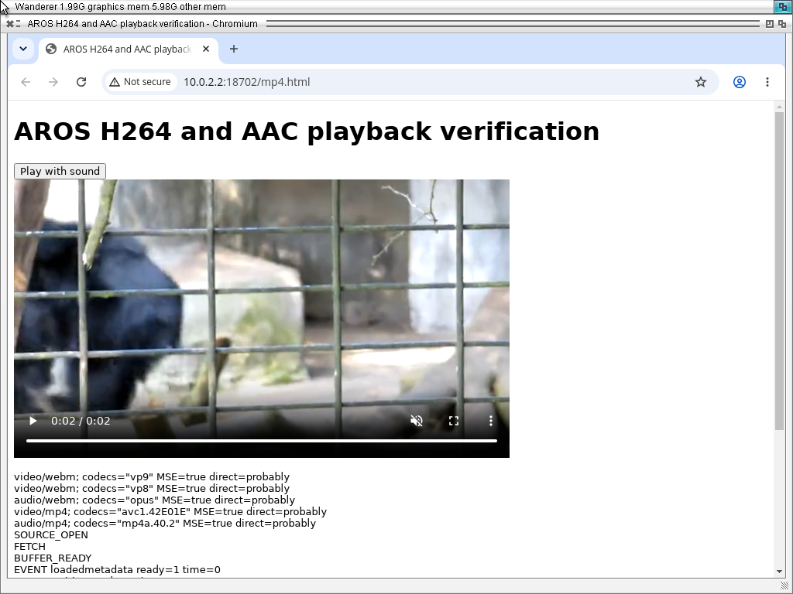
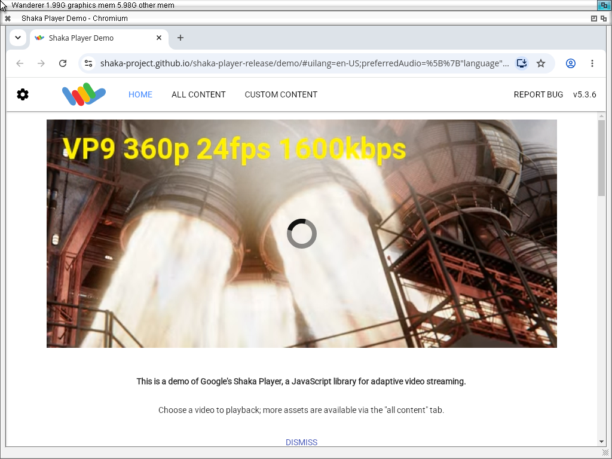
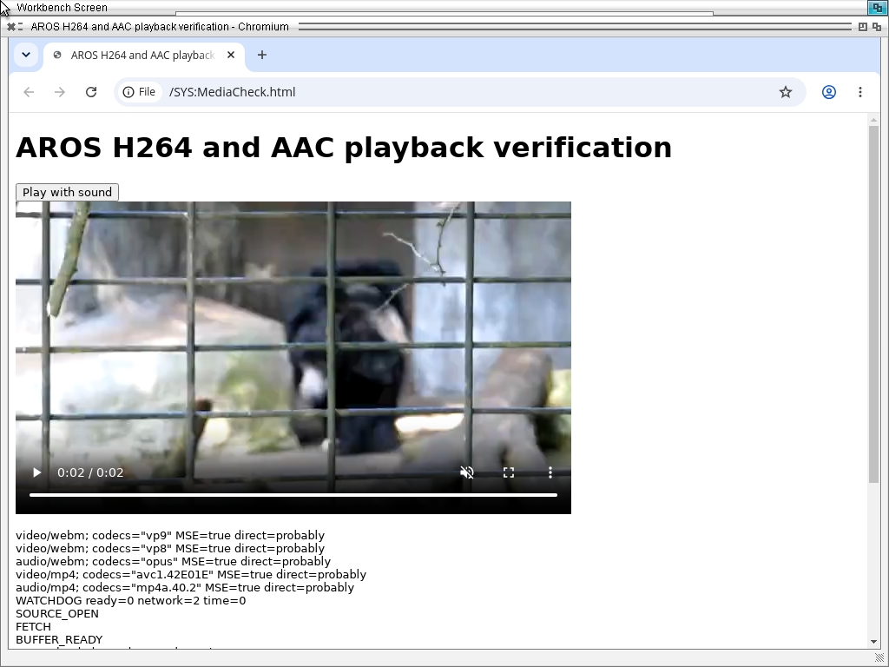

# Native codecs and current external Widevine — 2026-11-28 UTC

Source snapshot 724 and x64 engine 720 add native H.264/AAC support. The complete
Chromium archive and native link pass. The final image retains only the supported
absolute and relative relocations; no GOT/PLT packaging guard was relaxed.
FFmpeg had appended `-fPIC` after the native AROS flags; omitting that override
fixes the failed 706 final link. Codec worker creation uses native PlatformThread;
base synchronization still uses the existing AROS synchronization backend.

## Native H.264/AAC control

Fresh x64 run 728 (two cores, 8 GiB, e1000, HDA) passes the local fragmented-MP4
fixture through MediaSource, seek and replay. After two passes it reports 152 total
frames and 20 dropped; an unmuted third pass reaches 234 total frames and 32 dropped.
The HDA capture contains 228038 nonzero PCM samples. This is short-fixture playback
and output evidence, not an audio-quality or sustained-performance qualification.

## External CDM and loader

The old 4.10.2934.0 module failed the public Google Tears license request on both
AROS and an isolated host browser. The official Google package supplied external
module 4.10.3112.0; the same host control then reached 145.39 seconds and 3494 frames
without a reported error. The Chromium engine target remains 156.0.8078.96.

The [loader-private patch](../../aros/linuxso718-current-cdm.patch) applies to
AROS base recorded in loader-patch-replay.json, on top of the earlier master and
LinuxSO prerequisites. It adds missing Linux ABI adapters without adding generic
SDK interfaces. Native run 722 passes layout guards, descriptor flags/duplication,
thread queries, arithmetic, and CDM initialize/deinitialize/close. The
[probe source](../../tests/linuxso718-abi-probe.c) must be built with both ELF hash
styles for this loader. Guest signal masks are private bookkeeping, not POSIX
signal delivery or Exec signal masks.

Native run 723 accepts license updates, reports usable keys and displays frames
from the DRM sample. The trace confirms CDM decode-success callbacks, but does
not identify whether each input frame was encrypted or in the clear lead. However it repeatedly buffers and has delayed UI input.
Run 727 with Chromium detailed tracing off (loader tracing was still enabled: LINUXSO_DEBUG is enabled by presence, even when set to0) stalls near 0.3 seconds; a subsequent MP4 test
also stalls, while VP8 play/seek/replay passes. Fresh MP4-only run 728 passes.
**Sustained Widevine playback and session transitions remain unresolved.**

The current CDM remains an external privately installed module. No proprietary
module, license response, decrypted content buffer or key is redistributed here.
Full numeric stage tracing remains available through AROS_WIDEVINE_DEBUG.

## Remaining scope

Both ARM 712 and the sequential 726 archive/native builds pass. Fresh ARM run 732
passes the same short H.264/AAC fixture, embedded in a local page: play, seek and
replay produce 152 frames with zero reported drops using two native codec workers.
Whole-guest memory after playback is 1614.32 MiB out of 1977.93 MiB usable.
The offsets for the read-only memory measurement were regenerated with the
current master622 ARM SDK, and the total matches the native startup sample.

This is QEMU raspi4b emulation with the documented private preboot DTB upper-RAM
workaround. Audio hardware modes were disabled, so ARM audio output remains
unqualified. The result does not establish real-time performance, ARM networking,
physical-Pi readiness, memory plateau, long-session stability or an RC release. Earlier
ClearKey and lifecycle results retain their original build identities.
