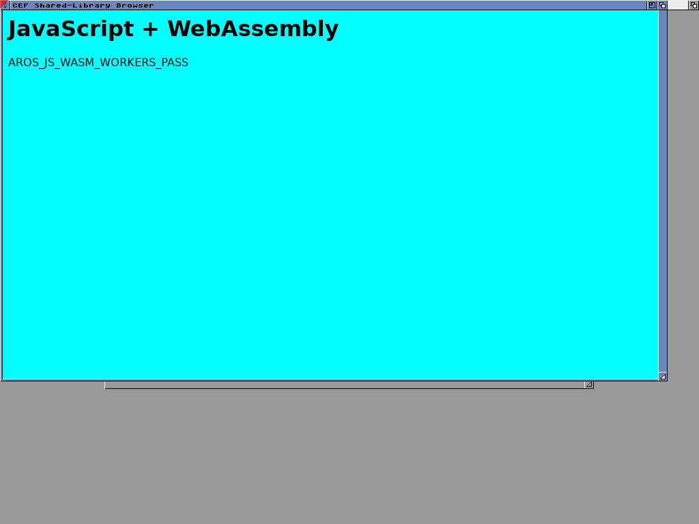

# Native resident-engine children: development evidence

The matching aros-web development commit is `be82ac7`. CEFHost's explicit
`--native-children` diagnostic mode launches the small CEFSubprocess helper via
the existing native AROS process/MessagePort implementation. Each helper opens
the resident libraries and executes its real child arguments.

## Verified boundaries

- Host/helper/browser-client cross-builds pass for x86-64 and AArch64.
- The first process-state candidate passes x64 complete archive and native
  module linking, normal SDK strip, and section-name compaction.
- Native x64 run 90 launches GPU, utility and renderer helpers. Parsed host,
  GPU and utility records share the same allocator/free addresses. Some later
  serial records interleave, so the machine-readable child list is incomplete.
- Run 90 advances beyond the prior histogram and extension-client singleton
  failures, then fails at `trace_startup_config.cc:97`: the tracing configuration
  is still shared across native processes. Its screenshot is a failed test,
  not a browser first-paint result.
- The snapshot now additionally scopes tracing startup configuration and its
  initialization flag to each process. Both complete CEF archive builds pass
  with that change. Run 91 clears tracing startup and exposes shared heap-profiler
  and HTTP-cache initialization state. Run 92 clears those checks after those
  values were scoped to their native owner.
- Run 92 then traps in PartitionAlloc logging and recurses through allocator
  dispatch. Exact installed ELF symbols identify duplicate hook insertion: the
  resident dispatch node becomes self-linked before the observer-hook check.
  Each parsed child matches its preceding host allocator addresses across three
  reboots. This is failed runtime evidence, with no first paint.
- The current snapshot serializes resident dispatcher installation with a native
  AROS lock before either observer mutation or hook insertion. Subsequent
  initialization returns under the documented first-initialization-wins contract.
  Both complete archives and native x64 linking pass. Run 93 clears this
  boundary and stops at the still-global memory-pressure listener registry.
  The allocation fast path has no new lock, and allocator checks remain intact.

`source-manifests.json` distinguishes the run-90 source tree from the later
tracing candidate. The candidate manifest was captured before archive completion;
the retained `cef-tracing-state-*-full1.log` files record subsequent successful
archive completion. `cef-host90-inputs.json` includes binary, source and fixture
hashes. Raw logs remain in the private job evidence; these public text copies
normalize CRLF and trailing whitespace only.

## Implementation and remaining work

Monotonic native CommandLine-owner identities keep workers with their owner and
separate native children. Histogram allocators, recorders and callbacks;
extension clients, permissions, manifests and feature metadata; and tracing
startup configuration now use that identity. Existing duplicate-initialization
and storage-partition checks are retained. No SDK, MMU or scheduler change is
part of this patch, and 2 MiB PartitionAlloc superpages remain unchanged.

The AROS histogram macro currently resolves through the owning recorder instead
of reusing a shared-image static pointer. That is a correctness-first path with
additional lookup cost, not a completed performance optimization. Process-local
registry entries currently retain engine-lifetime storage, matching upstream
NoDestructor usage; reclamation across repeated native child lifetimes still
needs qualification. Full Perfetto multi-process trace attribution is also not
qualified by a startup test.

Two-browser storage isolation, B continuing after A exits, callback draining,
child retirement, host shutdown, and ARM native-child runtime acceptance remain
open. Host session-only lifetime and earlier single-process browser/worker
results are separate evidence and do not establish those outcomes.

The run-92 input manifest pins the preceding cache/profiler candidate. The
current snapshot manifest pins the later allocator candidate; their runtime
claims are deliberately distinct. Run-92 address comparison is grouped by
preceding host because each guest reboot relocates its libraries.

## Memory-routing candidate

Run 93 fails at `memory_pressure_listener_registry.cc:96` before browser first
paint. Host, GPU and utility helpers share allocator addresses. Its screenshot
is retained privately; the public serial/result/input files pin the failure.
The result was saved before screenshot capture encountered an open QMP file;
the VM was paused and a separate capture then succeeded. This is no runtime pass.

The current snapshot scopes the memory-pressure listener registry, memory
consumer registry, and main-thread-default handle to each native process.
It also corrects child shutdown state, renderer main-task-runner storage, and
last-resort GC policy ownership found in the same audit. These prevent one
child from replacing or shutting down a sibling's state. Both complete archive
builds and native x64 link pass. Run 94 reaches host READY and then fails the
performance-scenario observer initialization check. All existing ownership
and duplicate-registration checks remain.

The current snapshot also scopes Blink main/compositor thread wrappers and main
heap storage to the native owner. Release heap access keeps the task-local fast
path. Performance scenario observer lists, mapping handles and their locks are
owner-local; the global scenario backing data stays shared. Both complete x64
and AArch64 CEF archive builds pass. Native library links and run 95 runtime
acceptance are pending. Existing initialization checks remain enabled.

## Direct-browser regression control

The direct browser using its default context passes on the memory-routing
candidate: page paint, same-origin cookie/localStorage checks, DOM and Worker
state checks through 60 seconds, browser close, and CEF shutdown all succeed.
`cef-direct94-control-*` pins that successful native x64 control (ISO run 97).
The preceding host/custom-context control (ISO run 96) was invalid for this
purpose: it hits the already known single-process storage-partition restriction.
Its failed result is retained and must not be called a new routing regression.

The direct control reports whole-guest use of 138.80 MiB before opening CEF,
879.88 MiB after opening it, 1550.92 MiB at first paint, and 1495.69 MiB after
closing CEF. These are whole-guest snapshots, not isolated browser RSS, and
closing a library is not proof of expunging resident engine allocations.
This control proves neither two-app isolation nor long-term memory reclamation.

Run 94's GPU free-pointer text was interleaved with other serial output; its
full address comparison is indeterminate. The parseable utility record matches
the host. A malformed log field must not be reported as an allocator mismatch.

## Scenario candidate runtime 95 and ARM control 23

Both native engine links pass for the scenario/Blink candidate published in
`ddcf15f`. Native x64 run 95 clears scenario initialization, starts renderers,
and fails the child memory coordinator singleton check at
`content/child/memory_coordinator/child_memory_coordinator.cc:24`.
All four parseable child records (GPU, utility and two renderers) use the host's
allocator/free addresses. This is not a two-browser isolation pass. The input
manifest pins the scenario source snapshot and installed binaries.

ARM control 23 uses the same scenario candidate and local JS/Wasm worker fixture.
It times out while opening CEF, before a worker result or teardown. It logs no
Chromium fatal or native alert. The 112.48 MiB sample is before opening CEF,
not browser memory use. ARM stall diagnosis is deferred; earlier worker passes
remain separate evidence and do not qualify this candidate.

## Child coordinator and WTF follow-up candidate

The current source snapshot scopes ChildMemoryCoordinator to its native owner,
retaining construction/destruction assertions. WTF initialization now uses the
existing monotonic process identity instead of a reusable CommandLine address.
An Exec-backed base lock serializes the complete engine-wide initialization;
each renderer still establishes main-thread TLS before that shared initialization.
Complete x64 and AArch64 archive builds pass. Native engine links and runtime 98
are pending. The compositor scheduler and WebRTC logging audit follow-ups are
not part of this snapshot, and repeated child lifetime reclamation is still open.

ARM 23 later completed after the bounded watcher ended: the retained
`cef-direct-arm23-late-*` evidence shows JS/Wasm workers PASS, painted/closed
cleanly and CEF teardown returned. The original timeout is preserved. First
paint uses 1185.19 MiB whole guest, after CEF close 1151.71 MiB; neither is
isolated RSS or proof of expunging the resident engine. The browser screenshot
was missed after the watcher ended, and guest shell RC was not routed to serial.
This late result qualifies the local worker exercise, not network or multi-app
behavior, and does not diagnose the long CEF-open interval.

## Child coordinator runtime 98

Both native links pass for the child-coordinator/WTF candidate. Run 98 clears
the prior child-coordinator assertion, then fails the FilesystemProxy containment
check: `/T:/CEFHostProfiles/Default/Login Data` and the Reporting/NEL database
cannot be made relative to `T:CEFHostProfiles`. The input manifest pins this
candidate and the result preserves the failure. Two-app acceptance remains open.

The cause is the older `sql::Database::ArosPathForSqlite` conversion, which
rewrites a native assign path for a Unix VFS workaround. The current AROS local
SQLite VFS already resolves DOS locks; the sandboxed VFS preserves the supplied
path for comparison with its root. The current snapshot removes the conversion
for database open and ATTACH and retains the root containment assertion.

The current snapshot also scopes the compositor scheduler pointer to each native
owner, matching the already owner-local thread wrappers and preserving existing
constructor/destructor checks. Both complete archive builds pass. Native links
and runtime 99 remain pending.

ARM run 24 passes with the preceding child-coordinator/WTF candidate: local
JS/Wasm workers, page paint, browser close, CEF teardown and explicit script RC0.
The rendered PNG was visually reviewed; the first-paint image was only a blank
cyan frame and is not used as worker proof. Whole-guest memory is 112.35 MiB
before CEF, 524.78 MiB after library open, 1185.15 MiB at first paint and
1151.89 MiB after CEF close. These measurements are not isolated browser RSS.
The browser covers most of About AROS in the screenshot. This is a native CEF
worker exercise, not full Chrome UI, network, or multi-app acceptance.

## Runtime 99 and storage/metrics/cache ownership follow-up

Native run 99 clears the path containment failure and reaches app A first paint
at 1674.30 MiB whole-guest use. It then fails the browser-only
`MojoUkmRecorder::MarkSourceForDeletion` NOTREACHED. The global UKM delegator
could forward browser calls to a renderer delegate. The current snapshot scopes
that delegator and its client registry to the native owner; the assertion stays.

The storage audit also found a utility process changing the engine-global
SQLite default and filesystem factory. Sandboxed VFS registrations now get
immutable owner-qualified names without replacing the engine default. Database
open/delete resolve the owner's default or explicit alias; ATTACH uses its
connection's VFS. The filesystem factory and persistent-cache VFS delegate,
registration guard and virtual-file map are owner-local. The prior AROS
workaround allowing a sandboxed VFS to replace VFSWrapper is removed.

The MemoryCache Persistent root and its dump provider's WeakPersistent pointer
are now per renderer, as are parkable string/image managers which hold renderer
task runners and background state. Engine code, allocator and stateless providers
remain shared. This does not qualify repeated child-state reclamation or full
Perfetto attribution. ProcessLocalValue lookup costs still need optimization
and measurement after native correctness is established.

Both complete x64 and AArch64 archive builds pass. Native links and run 100 are
pending. Run 100 additionally requires every logged child to report a successful
CEFExecuteProcess return; this precedes final CloseLibrary and is not proof of
task disappearance or resident memory reclamation. The retained watcher checks
are host synthetic acceptance-logic tests, not guest execution evidence.

ARM run 25 passes local JS/Wasm workers, page rendering, browser close, CEF
teardown and script RC0 on the preceding native-SQL-path candidate. Its screenshot
was visually reviewed. Whole guest is 1187.09 MiB at first paint and 1151.78 MiB
after CEF close. Network and two-app acceptance remain open. ARM 26 is prepared
for the current candidate with an opt-in test-client About AROS launcher.

### Native run100: renderer client ownership

Both renderer-caches native library links passed. Run100 connects app A and B, paints A, then the second renderer destroys the first renderer Chrome observer through the shared CEF renderer-client singleton. Exact retained symbol resolution identifies ChromeContentRendererClient::RenderThreadStarted, ChromeRenderThreadObserver destruction and Mojo receiver sequence failure. The check remains enabled. The new snapshot scopes both CEF and Chrome renderer-client LazyInstance storage to monotonic native owners, retaining AtExit behavior. New complete builds and native101 are pending.

The run100 first renderer entry is interleaved with allocator logging. Its result field `shared_allocator_addresses: true` describes only the three complete parsed records, not all four started children. The retained stack analysis records this qualification; the next watcher cross-checks child-memory entry counts before accepting allocator coverage. Run100 is a failure, not multi-app acceptance.

### ARM26 visual and runtime regression; extension ownership follow-up

ARM26 uses the preceding renderer-caches engine and aros-web test-client now published at a70c6cf. Local JS/Wasm workers PASS, browser paint/close PASS, CEF teardown returns and shell RC0. Screenshot visibly includes PASS text and native About AROS (aarch64-raspi ABI_V1, bfdbbd7c). First-paint whole-guest use1186.70MiB; after-close1147.91MiB. The earlier visual-review note was written before shutdown; the final result confirms clean return. This does not establish networking, full Chrome UI, multi-app isolation, or reclamation.

Final source snapshot adds renderer-owned extension client/dispatcher, extension and script registries, worker contexts and routing, frame/webview/document collections, isolated-world settings, localization and injection state, and incognito/instant flags. ScriptContextSet uniqueness DCHECK is restored. Immutable resources and resident engine code remain shared. Full3 archives and native101/ARM27 validation pending.

Final renderer-extension-state complete archives pass on both x64 (full3) and ARM (full3). Native links are in progress. Host-only watcher regressions reject incomplete child counts and mismatched allocator addresses, including the retained actual run100 interleaved log. These parser checks are not native runtime proof.

### Native101 DOM storage ownership and native clock contract

Both renderer-extension-state native links pass. Native101 reaches blank first paint in both windows, then localStorage.setItem uses a Mojo endpoint on the wrong sequence. Exact symbols identify StorageAreaProxy::GetAll, CachedStorageArea::EnsureLoaded and the V8 storage callback. The engine-global StorageController held renderer heap roots, namespaces and Mojo state. New snapshot scopes it per renderer without disabling sequence checks. Multi-app content/isolation/shutdown checks have not passed. Strict allocator parsing correctly reports unknown because one entry was interleaved.

The native x64 SDK clock probe requests100ms monotonic deadlines: NULL/default realtime attributes return after1082us, explicit monotonic attributes after100077us. Both SDK timeout calls return normally. Chromium had selected default attributes while computing monotonic deadlines; the new snapshot enables its existing monotonic attribute path on AROS. This is a Chromium adapter fix, not a direct Exec lock migration or explanation of ARM stalls. Native102 wrapper validation remains pending. The separate platform registry change replaces recycled CommandLine pointer identities with monotonic native owner IDs.

### ARM27 regression and DOM-storage archive completion

ARM27 preceding extension-state candidate passes local JS/Wasm workers, paint/close, teardown and RC0. Screenshot visually reviewed with PASS text and About AROS. First-paint whole guest1184.69MiB, after-close1148.46MiB. Native ARM clock probe measures16019us for legacy NULL attrs and119206us for matching monotonic attrs, for requested100ms deadlines. DOM-storage complete archives now PASS both architectures; native links and runtime102/ARM28 remain pending.

Exact run101/ARM27 ELF size audits are retained for future packaging optimization. They count static section payloads and tables, not resident memory or savings. x64 retains1,045,774 sections; ARM packager emits6. No linker/packaging changes are included in the DOM-storage candidate.

### Native102 crash-memory reporter ownership; ARM28 PASS

DOM-storage engine links pass both architectures. Native102 starts GPU, utility and three renderer children; all five allocator pairs are parsed and match the host. It fails when CrashMemoryMetricsReporterImpl::Bind replaces the engine-global reporter receiver from another renderer task. Exact stack resolution and failed screenshot are retained. A first-renderer RunLoop nesting-observer null fault follows; its cause has not been established or patched with a null-check workaround. Multi-app acceptance has not passed.

New reporter candidate creates one reporter per monotonic owner, publishes immutable entries, and performs only an existing-state lookup from the OOM callback. Owner lookup is nonblocking; unavailable/busy ownership or an uninitialized reporter skips that optional metric rather than allocating or recursively blocking under memory failure. The engine callback is installed once and atomically published on AROS; original duplicate-registration and Mojo sequence checks remain. Entry lifetimes are still engine-long; this is not reclamation proof. Final full2 archives PASS both CPUs; native103/ARM29 pending. A small native probe links the actual callback object to test empty and registered dispatch; it does not force OOM or establish SMP/reporting correctness.

ARM28 preceding DOM-storage/clock candidate PASS local workers, rendering, clean close, teardown and RC0. Reviewed screenshot shows PASS text with About AROS. Whole guest first-paint1188.80MiB, after-close1151.83MiB.

### Native103 reporter candidate

Both native engine links passed. Native103 no longer records the reporter Mojo fatal, but independently reproduces the first renderer teardown fault at RunLoop::RemoveNestingObserverOnCurrentThread+0x25; the stack caller resolves to SequenceManagerImpl destruction. Current-delegate lifetime diagnosis remains open. No isolation or shutdown pass is claimed. All five complete child allocator records match the host. Native clock and actual PartitionAlloc callback-object probes pass on x64 and ARM; they do not force OOM or qualify the reporter owner lookup under memory exhaustion. ARM29 browser acceptance is still pending. An unpublished diagnostic candidate adds AROS delegate/sequence-manager lifecycle logs without weakening checks.

### ARM29 reporter candidate PASS

Native local JavaScript/Wasm workers, paint, close, CEF teardown, and script return zero all pass, together with clock and actual PA callback-object probes. The retained worker screenshot shows the native browser and About AROS (aarch64-raspi ABI_V1, bfdbbd7c). Whole-guest used memory is 1197.93 MiB at first paint and 1156.24 MiB after close. These are not per-process RSS or reclamation measurements; network and native multi-app acceptance remain unproven. The delayed startup completed within its existing 1200-second test window; no scheduler change was made.

### Native104 and ThreadSpecific candidate

Native104 is a failure, not an isolation pass. B reports storage and heap/worker checks after A callback drain, but A reports no content checks, the survivor screenshot shows black content and stale pooled task-runner warnings, and child returns are incomplete. Host shutdown returns. Exact fatal symbols identify BlobRegistryProxy::Register through BlobDataHandle and the JavaScript Blob constructor; a utility task also faults removing a RunLoop nesting observer. Normal LOG-based lifecycle diagnostics yielded no serial events.

WTF ThreadSpecific selected an engine-global main_thread_storage_ cache on AROS even though the resident engine has multiple renderer main tasks. The current candidate selects the existing always-TLS branch on AROS, retaining all Mojo sequence checks. It also changes the temporary lifecycle diagnostics to direct KPrintF. x64 and ARM full rebuilds and native105/ARM30 tests are pending. No task-runner lifetime, clean child exit, or complete browser qualification is claimed.

## Native105 / ARM30 and next shutdown candidate

The task-TLS candidate passes ARM30 local JavaScript/Wasm workers, painting,
close, CEF teardown and native clock/OOM callback probes. Whole-guest first
paint is 1193.88 MiB; after-close 1151.76 MiB is not reclamation or process RSS.
The retained screenshot includes About AROS.

Native105 has no Blob sequence fatal. B continues its checks after A closes,
but A never reports its content checks: this is not two-app isolation PASS.
All five complete child allocator records match the host. Direct lifecycle
logs identify a utility task destroying the browser-owned UI SequenceManager:
ContentMainRunner shutdown unconditionally reaches image-global
BrowserTaskExecutor. The new candidate scopes that pointer to the native owner.
Normal AROS GPU exit also now returns through GpuMain and the existing Viz
destructor instead of calling resident-library stdc _exit without a startup
frame. Abnormal fail-fast behavior is unchanged and remains unqualified.
Both fixes await native106/ARM31 validation; no full browser release claim.

## Native106 resource lifetime follow-up

The browser-executor/GPU candidate links on both architectures. Native106
records a renderer returning0, then multiple other tasks fail the ResourceBundle
shared-instance CHECK. ChromeMainDelegate::ProcessExiting calls resource
cleanup for children; its image-global pointer allowed one renderer to delete
resources still used by siblings. The current snapshot scopes the ResourceBundle
pointer to its native owner, preserving initialization and cleanup checks.
Native107/ARM32 validation is pending. ARM31's preceding candidate is still
under observation; no ARM31 result is claimed here.

The original105 fixture and106 diagnostic fixture are both retained. Startup
phase/error logging was added without weakening storage, DOM or worker checks.
No two-app isolation, complete child retirement or reclamation PASS is claimed.

## Native107 / ARM31–32 and retirement candidate

ARM31 and ARM32 pass the local JS/Wasm worker, paint/close, CEF teardown and
native-probe regression. Whole-guest first paint is1182.73MiB and1184.78MiB
respectively; these are not process RSS or measured optimization gains.
Native107 clears the ResourceBundle failure and records two renderer return0
records, then the host fails ChromeProcessSingleton::GetInstance after child
cleanup deleted the engine-global singleton. No app content/isolation PASS.

The new snapshot scopes ChromeProcessSingleton and all four linked paint GC
roots by native owner. It retains one paint-root family across a renderer's
tasks. Failed native kill now checks task liveness instead of treating errno0
as successful retirement. Helper command-line state retires after runner and
delegate cleanup; Exec task IDs and null retired-owner entries prevent stale
address reuse and accidental fallback to browser-parent state. A runtime CHECK
verifies the retired helper no longer observes an initialized command line.

Initial changed objects pass both architectures. Final edits crossed an
in-flight archive verification; the coordinator was paused and frozen-source
archive confirmation is being rerun before native linking. Native108/ARM33
remain pending. Paint-root retention is not renderer heap reclamation proof.

### Renderer coordinator ownership candidate

The preceding candidate passed complete archives and native links on x86-64 and AArch64. ARM33 passed local JavaScript/Wasm workers, painting, closing, teardown, and clock/allocator callback probes. Whole-guest used memory was 1184.22 MiB at first paint and 1152.33 MiB after CEF close; these are not browser RSS or reclaimed-heap measurements.

Native108 could not fetch the fixture (local server absent) and separately hit a Mojo sequence check in the renderer main-thread load report. Exact ELF symbols identify ProcessCoordinationUnitProxy::SetMainThreadTaskLoadIsLow. RendererResourceCoordinator had a single resident global pointer; the new snapshot scopes that pointer to the native logical owner and retains sequence validation. Build/runtime validation for this additional change is pending.

Native109 uses the same engine, facade, and fixture hashes as108 with the server restored; both app requests returned HTTP200. Host shutdown, three renderer returns, and GPU return completed without a fatal. However, neither app painted before the diagnostic startup deadline and the utility return was absent, so strict acceptance failed. Native110 is an independent longer-startup comparison using the same engine/facade and only an optional diagnostic wait-budget change (aros-web11000c2); results pending.

Read-only audits retain follow-up contracts for path-cache ownership and main-isolate destruction. No renderer-heap reclamation change or memory-reduction claim is included. The source snapshot is replay-checked against its pinned bases and remains in progress.

The completed native110 timing comparison did not qualify app content: both HTTP requests succeeded, B produced a paint callback, but neither app emitted its JS/content checks and A aborted at tick6001. A later utility hit a native stdc exit-frame alert; no Chromium caller stack was emitted, so its cause is unresolved. Native111 will test the coordinator ownership fix.

### Exit and page-lifecycle diagnostics

The renderer coordinator fix passed both complete archives/native links. ARM34 passed local workers, painting/close, teardown and contract probes (whole guest1195.10MiB first paint,1155.84MiB after close). Native111 reached B script-start and both paint/callback-close records, then returned from host shutdown without a fatal/alert. It still failed strict acceptance: no app content/worker checks and incomplete child returns (1/3 renderers,1/2 utilities,1/1 GPU). Its survivor screenshot is black, not proof of useful rendering.

The new source snapshot adds immediate-exit task/Exec-ID/code and caller stack diagnostics on AROS while preserving termination behavior. Companion aros-web36a12a8 adds request-handler document/renderer callbacks and cross-builds on both architectures. A separate fixture adds cookie/local-storage phase markers, with acceptance unchanged. Diagnostic candidate112/ARM35 native links and runtime are pending.

A separate read-only audit identifies ServiceBinderImpl resident optional storage holding the first utility main runner and IO factory across helpers. A per-owner draft exists locally but is not included in this snapshot. A worker-generation audit is also deferred; neither is claimed as a measured cause of the current blank page or exit alert.

### Utility service-binder ownership candidate

Native112 retained the previously opaque immediate-exit caller: utility task180 requests exit0 from ChildThreadImpl::EnsureConnected, through UtilityMain. The native stdc exit-frame alert follows. This establishes a connection-timeout trigger; it does not yet establish why the Ping/connection failed. Both fixture requests succeeded but the app content checks failed. ARM35 is still running its local regression.

The new snapshot scopes ServiceBinderImpl optional storage by logical native owner. Its captured main runner, IO ServiceFactory, service count and WeakPtrFactory are no longer shared by different native utility processes. Same-owner sharing and existing reset semantics remain. Both archives passed; native link/runtime validation113/ARM36 is pending. Companion aros-web7d1a36a adds optional --debug-native host system logging and helper service subtype/Exec-ID records; both architectures cross-build. Native113 explicitly enables system logging. The immediate-exit diagnostic remains; neither timeouts nor failure checks are suppressed.

### Mojo connection ownership candidate

The utility-binder candidate passed both complete archives and native links. Native113 system logging identifies a storage-service utility and a stale pooled-task-runner rejection during Mojo trap dispatch. Its exact retained ELF resolves the path through MojoTrap, ipcz NodeLink/Router and ChannelAros. Both app scripts complete cookie writes and reach the marker before localStorage write; storage/worker acceptance remains pending. The stack evidence is retained separately and does not alone prove which global caused the mismatch.

The new snapshot scopes Mojo IPC node/options, transport IO runner, configuration, memv2 policy and default process-error callback to the logical AROS owner. Previously every child initialization overwrote the resident node and every ScopedIPCSupport overwrote the same IO runner. Workers within one logical owner still share these values. Non-AROS behavior retains process-wide state. The patch does not suppress connection timeouts or claim node/renderer heap reclamation. Exact-base replay passed; complete archive and native114/ARM37 runtime validation are pending.

Native113 completed strict FAIL at its fixed deadline: both scripts completed cookie-write calls and stopped before localStorage.setItem returned. Neither storage/worker isolation check passed, neither app closed, and host teardown did not return. No fatal/native alert occurred. Verbose logs interleaved one child allocator record, so allocator-address coverage is unqualified for this run. The black screenshot is retained as failure evidence, not a successful two-app rendering result.

ARM35 passed its local JS/Wasm worker and native contract probes, but timed out during CEF teardown without a fatal/native alert. Whole-guest used memory was 1186.39 MiB at first paint and 1232.49 MiB before teardown; no post-close measurement exists. The worker screenshot visibly displays PASS and About AROS. ARM stalls remain a deferred OS investigation per the user, and do not block the next isolated engine candidate.

The Mojo ownership candidate now passes complete archives on both architectures. Native114/ARM37 final links/runtime remain pending. Public source6d8ce6a is a work-in-progress snapshot, not a runtime acceptance claim.

### Visible multi-app content pass; raster and V8 bridge follow-up

Native114 with Mojo owner isolation renders both app windows and repeatedly passes independent cookie/localStorage, DOM and worker checks. The retained two-app screenshot shows real PASS content. Strict lifecycle acceptance still fails: closure exposes a shared raster pool job-handle mismatch, followed by a native alert at an unresolved cppgc write-barrier import. The exact ELF stack resolves the remaining task-pool rejection through CategorizedWorkerPoolJob::ScheduleTasks; its GetWorkerPool singleton retains the first renderer pool. The new snapshot isolates that storage by logical owner without weakening JobHandle validation.

The missing write-barrier function exists in native v8.library at ELF section71929. AROS debug RegisterModule_ELF explicitly skips SHN_XINDEX symbols, explaining the lookup miss. Companion aros-webc5de7e8 generates a direct import-address table from the matching manifest and consults it before debug enumeration. Defined functions resolve through native linker relocations; optional absent legacy imports remain NULL and retain the existing failure path. Two host generator/linkage checks and both native V8 builds pass. Native115 explicitly stages the new V8 library and uses the ordinary logging mode, because verbose system output interleaved allocator records in114. ARM38 copies and SHA-verifies the new V8 library onto the stopped VM's SD image. Runtime validation remains pending.

ARM36 passed its complete local worker/paint/close/teardown regression and native contract probes. Whole-guest used memory was1184.81MiB first paint and1151.78MiB after close. This is not multi-app ARM acceptance or reclaimed-renderer-heap proof.

### Renderer frame-map lifecycle candidate

Native115 uses the rebuilt direct-import V8 library (hash checked against native build output) plus per-owner raster pools, with ordinary logging. Both apps again pass storage/DOM/worker checks. Strict lifecycle FAIL now occurs at RenderFrameImpl::FrameDetached's frame-membership CHECK. The exact-ELF stack is retained. The global LazyInstance<FrameMap>::DestructorAtExit registers destruction with the first renderer; that exit can clear a sibling's live frame map. The new candidate scopes the LazyInstance wrapper by logical renderer and retains normal AtExit destruction and both membership/identity checks. This does not bypass teardown or claim heap reclamation. Complete build/native116/ARM39 validation is pending.

ARM37 passed content/workers and browser-close callbacks, but timed out in final CEF teardown without a native alert or fatal. Its retained inputs still contain the preceding V8 library; ARM38 is running the direct-table library with independently verified staging hashes. A separate profile-lock audit records an unsupported F_SETLK consumer and an existing SDK flock implementation with different lifetime semantics; no locking or SDK change is included.

## Native116 and ARM38; Blink page/frame ownership candidate

Native116 repeats both applications storage, DOM and worker PASS, with complete shared allocator-address records. Full lifecycle remains FAIL: the exact retained ELF resolves the next close-path CHECK to LocalFrame::DetachImpl (frame-token map membership), after the preceding RenderFrameImpl map fix. No surviving-app or full teardown acceptance. Screenshot and exact-symbol stack retained.

The next snapshot scopes Blink AllPages/OrdinaryPages Persistent roots, local/remote frame-token maps, empty ChromeClient and WebView instance registry to each logical renderer, preserving sharing within the renderer and existing CHECKs. Both architecture compilations are in progress; native117/ARM40 are pending. No heap reclamation claim.

ARM38 used the new direct V8 import table, passed local JS/Wasm workers and paint/close, but timed out during final teardown without fatal/native alert. First-paint whole guest usage 1178.32 MiB; not engine RSS, network or multi-app acceptance. ARM39 separately tests the preceding frame-map snapshot.

ARM39 completes the preceding frame-map candidate with full local JS/Wasm worker, paint/close, final teardown and clock/OOM callback probe PASS. First-paint whole guest 1174.26 MiB; after library close 1143.28 MiB. Screenshot includes native aarch64 About AROS. This is QEMU local single-browser evidence, not network, hardware, multi-app or full-browser acceptance.

ARM40 validates the current five-file Blink-root snapshot: complete local worker, paint/close, teardown and callback/clock probe PASS; 1176.28 MiB firstpaint and1143.97 MiB afterclose whole guest. The following test-client change6badd68 releases two CefBrowser arguments transferred by the generated request-handler CToCpp callbacks. Host-test reference-count diagnosticsdfbb366 preserve the unload guard. Both clients rebuilt on both architectures; native118/ARM41 pending with unchanged engine binaries.

Native117 final result is strict FAIL by timeout, with both content/worker checks PASS, all three renderer returns0, one of two utility returns0, no fatal or native alert. Both browser-close callbacks arrived; app callback-drain and host shutdown did not pass. This removes the previous frame-map assertions from the observed path without claiming complete lifecycle success. Native118 isolates the test-client callback reference fix against identical engine binaries.
