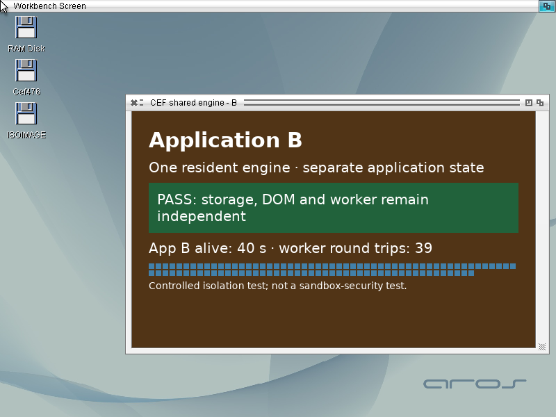

# Permission registry lifetime: source462 / native463

The extension permission registry now uses native owner AtExit destruction. The retained earlier dump found 5,400 API permission objects belonging to 30 exited renderers. The new thirty-cycle run logs 31 registry releases, including the host.

Both x86_64 and AArch64 native libraries link. On x64 QEMU, profile466 passes synthetic cookie/localStorage close/reopen persistence. Thirty-cycle465 passes all pages, all 32 child entry/exit pairs and 30 isolate retirements with none deferred. Whole-guest memory still grows 36.705 MiB between cycles10 and30, reaching 1095.608 MiB; after host exit it is949.130 MiB. This change does not establish a memory plateau or a measurable whole-guest saving.

Single-core sibling476 passes two-app storage/DOM/worker independence, B surviving A closure, four child entry/exit pairs and both retirements. Its original result mistakenly expected predecessor473 terminal markers inside an f-string. The separate corrected audit verifies actual476 markers against the retained serial hash; the original failure remains here.

Earlier sibling456/464/470/471 are invalid harness attempts: numeric script substitution changed the fixed MBR partition-table offset446. They do not establish an AROS, SMP or Chromium failure. Fresh476/477 preserve numeric constants and verify partition geometry before boot. The corrected two-core477 attempt timed out after GPU/utility startup without rendering or an explicit native fault. Its cause remains undiagnosed; it is separate from the earlier invalid-MBR attempts.

ARM visual evidence in ../arm460 applies to source444/native445, not this candidate. The newer renderer-resource cleanup source468/native469 remains unpublished and under test. No RC or physical-device qualification is claimed.
