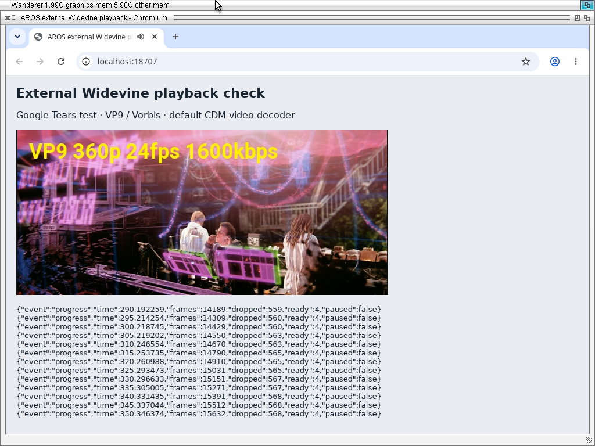
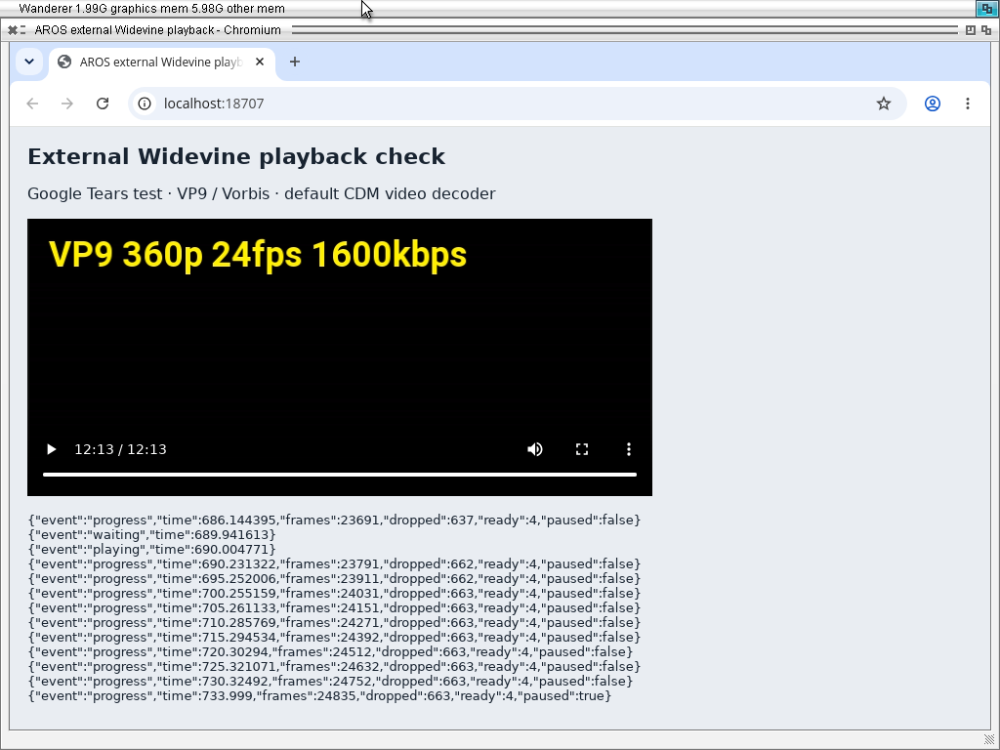
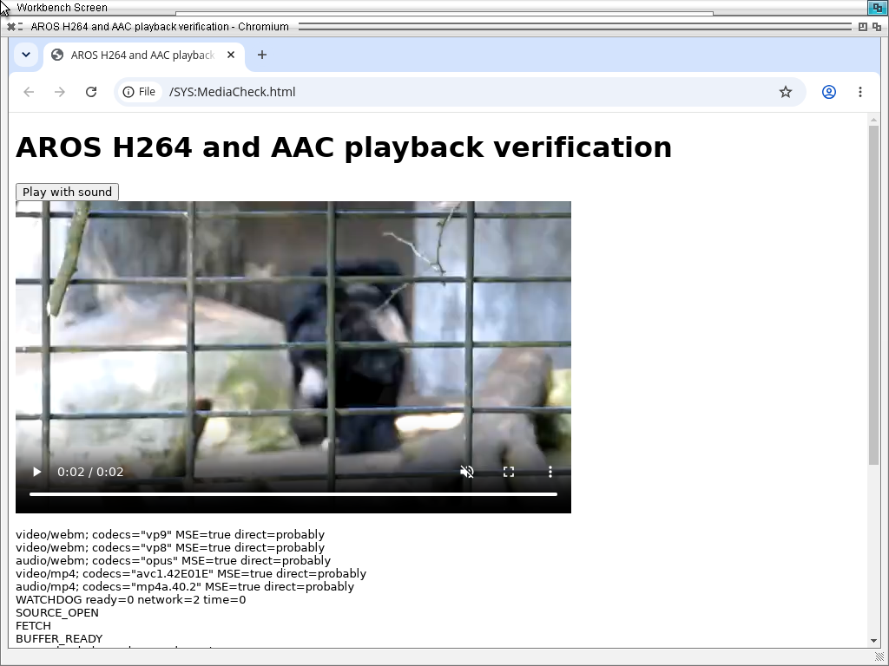
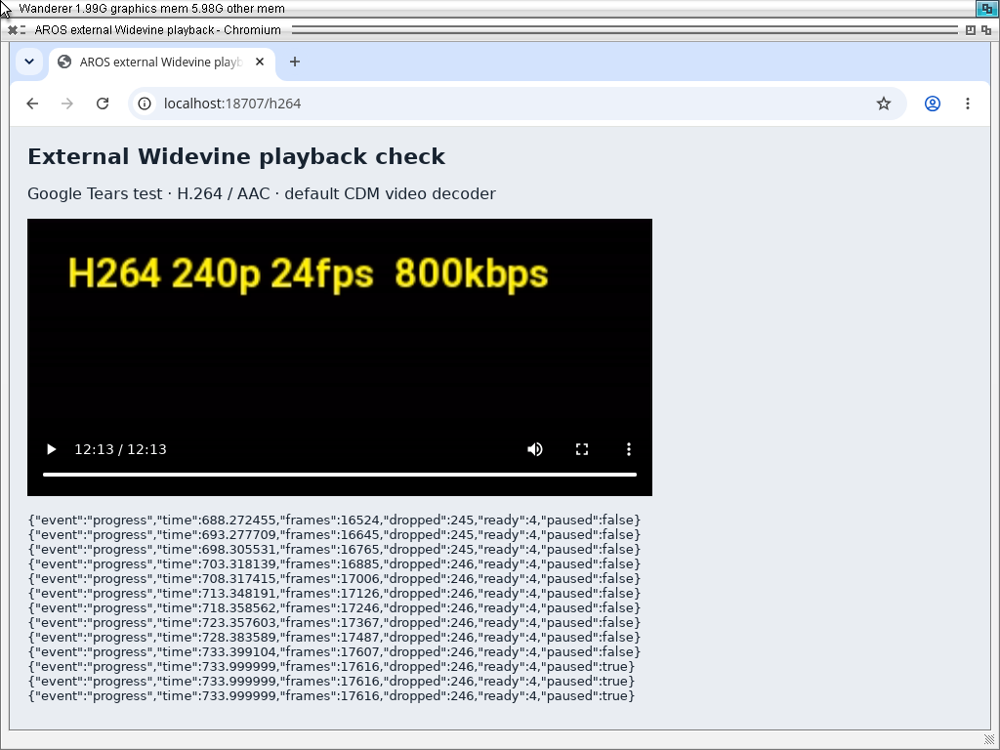

# Corrected-engine encrypted playback validation

The source749 engine completed an uninterrupted 733.999-second encrypted VP9/Vorbis replay in native x86-64 AROS under QEMU, with audio enabled. The browser used the external Widevine 4.10.3112.0 module through linuxso and the graphics741 WaitTOF correction.

The replay advanced from 0.256665 seconds to the endpoint without another seek or pause command. Periodic samples show 17,606 additional frames and 200 additional dropped frames. No harness error or native fault marker was observed during that interval. The earlier session included seeking and a background-tab pause; those are not included in this full-replay claim.

The live audio capture contains 75,835,054 nonzero signed 16-bit samples across the session, with peak magnitude 16,384. This proves generated guest PCM, not physical audio output. Memory samples are whole-guest usage, filtered for internally consistent counters; they are not engine-only measurements.

## Other checks and limits

- The independent native HTTP range/cache fixture completed 40 content-verified requests, including overlapping ranges and concurrent requests.
- ARM751 completes the full archive and native link for source749. Runtime753 completes native ARM offline H.264/AAC playback, seeking and replay: 152 frames, zero dropped. Audio hardware modes were disabled, and neither networking nor ARM Widevine is qualified. Startup was slow; this is not a performance qualification.
- Intermittent real-stream cache errors remain. A later private diagnostic build identifies a blockfile range query while another sparse operation is active; the fix is still under investigation.
- The separate cache754/runtime755 run also completes the full 733.999999-second encrypted H.264/AAC sample: 17,616 frames, 246 dropped, no player error or native fault marker. Audio was unmuted around112 seconds; captured PCM contains53,746,327 nonzero samples. This build adds failure-only cache diagnostics to source749; it does not change cache semantics. See h264755.json for the exact library hash and limitations.
- No proprietary CDM, profiles, audio or RAM dumps are redistributed. This is validation evidence for an in-progress port, not an RC release.

