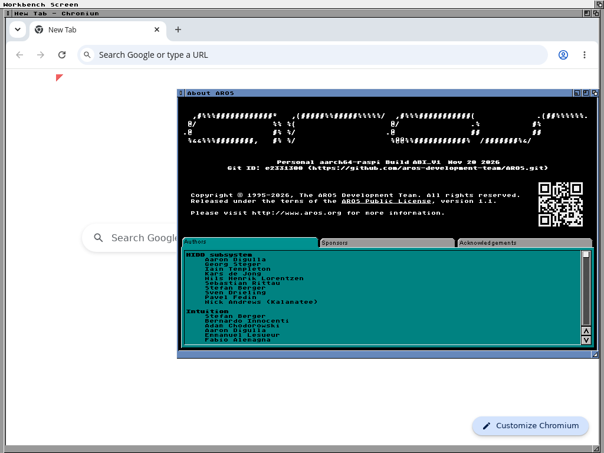

# Production browser startup and shutdown findings

The production379 engine artifacts are verified for both architectures. ARM384 renders Chromium New Tab with native About AROS in the foreground. Its whole guest uses1579.32MiB with398.61MiB free; this is not browser-only RSS or a physical Raspberry Pi result.

The x64 publication step initially failed because scratch storage and the installed library were on different volumes. The tested helper404 now copies to a verified temporary file beside the destination before atomic replacement. The already-linked379 artifact was recovered with its original hashes and explicit failure provenance. This helper is published in aros-web commit ba224a3 on chromium-156-aros-cef.

The x64 production browser385 renders and writes the controlled cookie/localStorage fixture. Closing it exposes a required observer-notification ordering violation; its close/reopen test fails. The staged413 correction restores the exit notification for retiring hosts while retaining navigation liveness guards.

Source398 is included in the snapshot. It cancels navigation when main-frame reinitialization fails rather than dereferencing an absent frame host. All21 repository patches replay and both cross archives400 pass; native400 links and runtime qualification remain pending.

The retained365 memory dump contains65 owner-registry IPC node handles, all matching the exact Node vtable. This establishes retained handles after host exit, not their attributable byte total. Child-only closure412 is staged privately for subsequent lifecycle and isolation testing. No RC or memory plateau is claimed. See [current release gates](release-candidate-gates.json).
