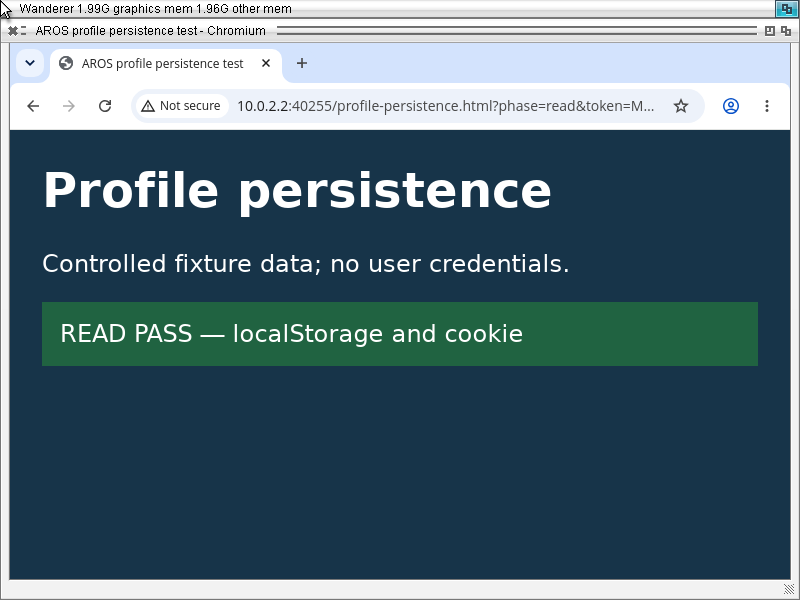

# Profile close/reopen recovery

The425 timeout was a synthetic input mismatch: the entered URL contained MSTER425 while the test awaited MASTER425. The original browser serial already records successful cookie/localStorage writes with the actual token.

Recovery435 uses that stored token and slower input. Native Chromium closes, drains callbacks, reopens, and reports READ PASS for both localStorage and cookie, without a native fault. This validates source421/native422 for this controlled workflow, not real account sign-in or a coldboot test.

The separate426 renderer lifecycle candidate declines fast shutdown. Thirty pages and all32 child exits complete, but all30 isolate retirements remain deferred. The result field functional_pass covers the page loop; it is not release acceptance. Normal host cleanup still closes IPC before deferred Blink view teardown completes. Source436 tests explicit owner-local view closure before scheduler shutdown; it is not yet runtime-qualified or included in the current source421 snapshot.

[Current release gates](release-candidate-gates.json)
