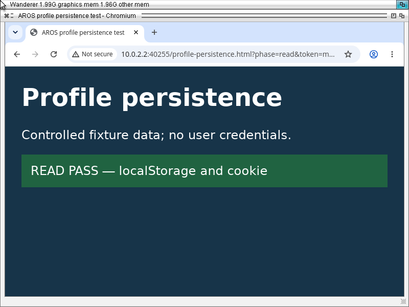

# Renderer resource teardown: source468 / native469

Renderer-bound extension dispatcher, V8 schema handles, Chrome observer, cache, logging, spellcheck and related resources now close after owner views/workers drain and before scheduler/isolate retirement. They previously survived until AtExit, where the scheduler/isolate were already unavailable and objects were deliberately retained. The existing bounded worker timeout keeps its safe-retention fallback.

Both x86_64 and AArch64 native links pass. On x64 QEMU, sibling473 passes every two-app storage/DOM/worker isolation gate, B surviving A closure, all four child entry/exit pairs and both completed retirements with none deferred. Profile475 passes synthetic cookie/localStorage write, close, reopen and read without native faults. Logs show resource release preceding isolate retirement.

Thirty-cycle474 is running; early memory samples still grow. ARM479 has booted its desktop, but browser rendering and memory acceptance remain pending. No memory saving, RC or physical-device qualification is claimed. Native484 contains a subsequent private raster-pool cleanup and is not this snapshot.
