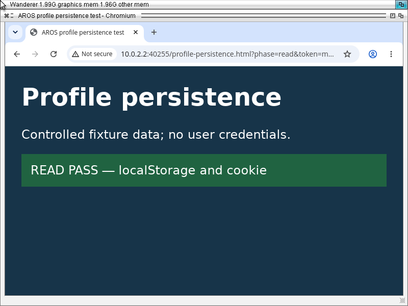
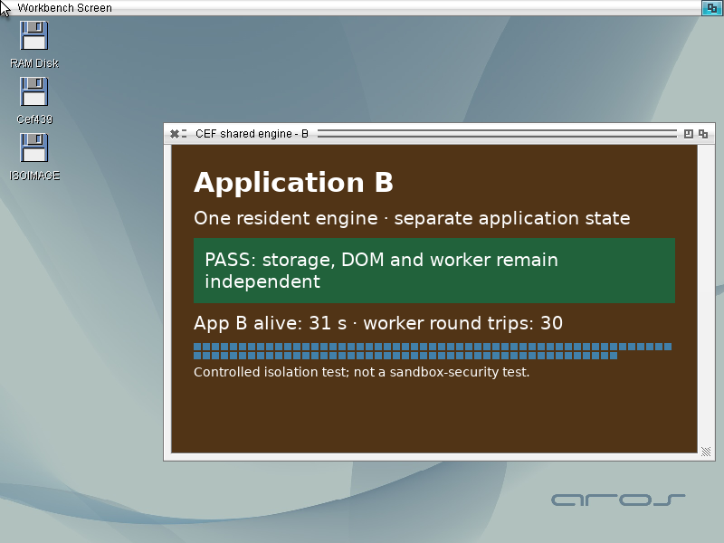

# Renderer view shutdown and native browser profiles

Source442 / native443 explicitly closes only the current renderer's Blink views
before stopping its GPU channel and scheduler. Weak deferred callbacks prevent a
second close after synchronous teardown. Both x64 and ARM native links pass.

Fresh x64 profile440 passes synthetic cookie and localStorage write, close with
callbacks drained, reopen, and read. This does not qualify real sign-in or cold boot.

Sibling439 passes storage, DOM and worker-state independence, app B survival after
app A closes, and independent native child entry/exit records. Both renderer
retirements still defer with pages=0, workers=1. The workers begin shutdown but
post their final proxy destruction to the parent loop that has already stopped.
Source444 is a bounded native callback-drain candidate under test, not in snapshot442.

Thirty-cycle438 passes all 30 pages, 30 complete and zero deferred isolate
retirements, and independent entry/exit records for all 32 children. Whole-guest
used memory rises from 1,058.77 MiB at cycle10 to 1,095.47 MiB at cycle30
(+36.71 MiB); after host exit it is 948.98 MiB. This is not browser RSS, and
memory plateau remains unresolved. Neither this bounded result nor compilation
qualifies an RC. Shared address space is not a
sandbox boundary. ARM443 runtime, browser Vulkan, Widevine, physical Pi, and the
other engine consumers remain separate acceptance work.
