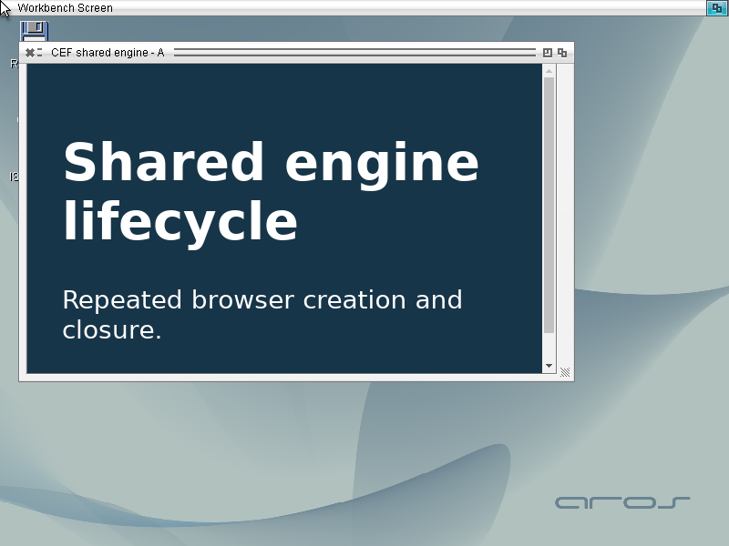
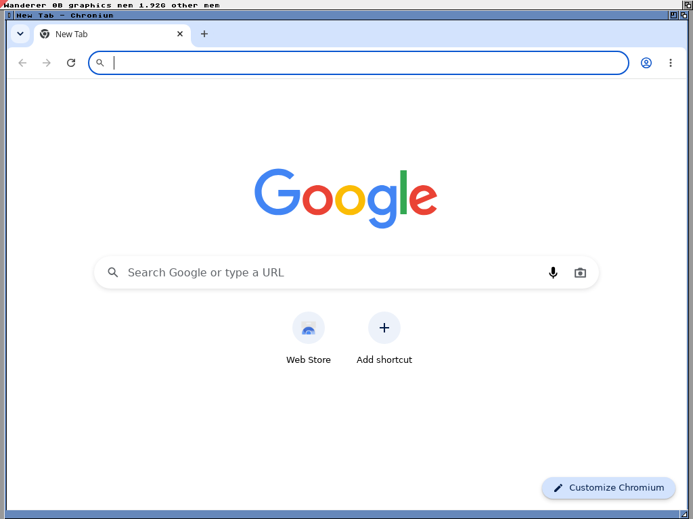

# Four-slot superpage backing and native validation

Source snapshot585 keeps on-demand 2 MiB PartitionAlloc superpages. Up to four
slots share one 10 MiB Exec allocation, amortizing alignment padding. Slots keep
independent protection and zero-on-reuse; the backing is freed only when every
slot is unused. This does not add SDK mmap or alter JIT/shared-memory allocation.

Both full CEF archives586 and native libraries587 build. The snapshot replays
across 21 repositories. The portable host test extracts the production functions
and passes allocation-failure cleanup, alignment, zeroed reuse, sibling page
protection/data survival, full release, and eight-thread churn. It uses mocked
Exec allocation and host protection, so it is not native AROS SMP qualification.

Run it against the patched Chromium source:

```sh
python3 upgrade/156/tests/test_aros_superpage_arena.py /path/to/chromium/src --output /path/to/new-test-output
```

## X64 native hundred-cycle result

Run588 passes 100 pages, 100 renderer retirements, zero deferred retirements,
complete host shutdown, and 102 child-owned entry/exit pairs (100 renderer,
one GPU, one utility), all returning zero. No SQLite errors were observed.
The raw serial-only audit fails because a DETAIL id119 was split into `1`
and `19` by a concurrent launch log. The exact line and corroborating complete
E119/native119 records are retained in `runtime588-reconciled-audit.json`.
Both original strict failure reports and all 204 native ledger records remain.
The disk was read only after the exact VM exited, with its hash unchanged.

| Whole-guest use | Prior run552 | Current run588 |
| --- | ---: | ---: |
| Cycle30 |1274.87 MiB|1238.83 MiB|
| Cycle100 |1429.36 MiB|1334.40 MiB|
| After host exit |1270.38 MiB|1175.28 MiB|
| Growth, cycles30–100 |154.49 MiB|95.57 MiB|

The OS, clients and V8 are held fixed, but CEF527 versus587 also includes
intervening cache/resolver fixes: this is not a pure allocator-only A/B.
These are whole-guest measurements, not per-process RSS. The final PA snapshot
has 184.22 MiB of Exec backing for 139.72 MiB exposed, leaving 44.50 MiB overhead.
The main root still reserves 66 superpages with about 43.94 million live bytes.
**Memory still grows; no plateau or RC is claimed.**



## ARM normal-host result

Run600 paints the full New Tab page with native587, normal host554 and the
unchanged refreshed583b OS boot set (private source80beff963b94, upstream
9c39558be350). RAM and FAT cache-lock probes pass. This is native QEMU with
software rendering, not physical Raspberry Pi or hardware Vulkan qualification.



The earlier590/592/593 failures came from a test-script substitution: changing
run576 to584 also changed `Stack 1048576` to `Stack 1048584`. The extra eight bytes misaligned the host stack
and caused a Rust PNG destructor to free 0x80. A paired diagnostic host with the
same extra stack allocation passed at 16-byte alignment and reproduced the fault
at 8-byte alignment. Run600 changes only the script's stack command compared with
592; engine, host and boot hashes match. No OS alignment patch or diagnostic
host is required for this result. A private NewStackSwap hardening experiment
was preserved separately and its source restored; it is not in this snapshot.

The 90-second marker preceded full rendering, so the later screenshot supplies
visual proof. This run does not test browser shutdown or external networking.
Previous572 cold-boot profile/isolation results remain separately recorded;
final candidate replays, memory stability and release packaging remain open.
