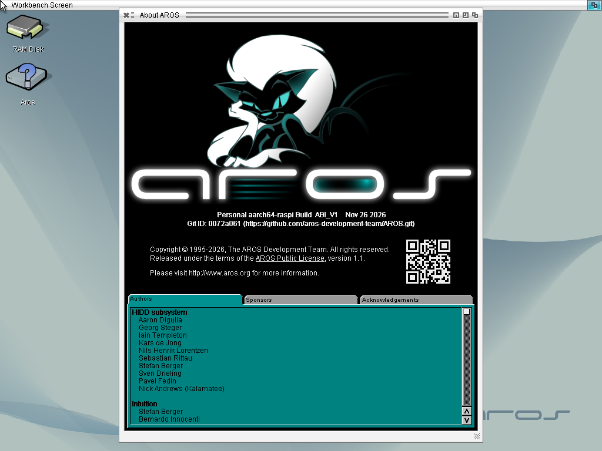

# Release task storage on self-removal

Apply `task-storage-self-removal.patch` **after** the [master632 prerequisite patch](../master632/README.md). It advances private AROS source `0072a0613f224ce91aaad46e2aaf351b45c0b706` to `b54902840a832b4eb62461cdfba4c6cc918d6b92`. An independent index replay exactly matches tree `df0ffb1899bbe6502a50b2b68f24f5beef97ad4b`; see `source-replay.json`.

The task.resource RemTask wrapper freed its slot array after calling Exec RemTask. Self-removal never returns, so that cleanup was unreachable. The correction detaches the current task's array under the existing slot lock, releases it before self-removal, and retains post-removal cleanup for a foreign task. Removal observers still run first. No SDK ABI or Chromium allocation policy changes.

The native regression `developer/debug/test/taskres/taskstorage_exit.c` creates DOS processes that explicitly allocate task storage and then exit. It needs neither pthread nor Vulkan. Both warmup and final memory readings allow deferred SMP stack reclamation to settle. Run on an otherwise quiet system because AvailMem is whole-system accounting.

## Native controlled results

Each row reports three runs, each measuring 20 lifecycle operations:

| Architecture/control | Original kernel: bytes lost | Fixed kernel: bytes lost |
| --- | --- | --- |
| x64 native task storage | 5152, 5120, 5120 | 0, 0, 0 |
| ARM native task storage | 5120, 5120, 5120 | 0, 0, 0 |
| x64 settled thread lifecycle | 2576, 2592, 2624 | 0, 0, 0 |
| ARM settled thread lifecycle | 2592, 2592, 2592 | 0, 0, 0 |
| x64 settled Vulkan device lifecycle | 12864, 12832, 12816 | 0, 0, 0 |

The task-storage probe's slot 16 allocates 32 eight-byte slots, explaining the 256-byte-per-process loss. The thread control uses a smaller slot array. The fixed x64 run also passes native Vulkan device enumeration and queue submission: Vulkan 1.4.354, llvmpipe (LLVM 20.1.0), all 1024 buffer words correct. This is software Vulkan in QEMU, not physical RADV/NVK qualification.

Initial tests that measured immediately after joining workers were contaminated by deferred task-stack reclamation. Delaying only the final reading produced misleading negative losses because warmup stacks were still live at the baseline. The table uses symmetric settled readings. Original control logs are retained here; the broader diagnostic sequence is registered on JOB-0254.

Both rebuilt kernels leave every existing file in the frozen SDK623 manifests unchanged. The ARM build retains the two-core cap and its QEMU upper-RAM workaround. The fixed binaries were built before committing the change, so About AROS still displays the base revision 0072a061; exact kernel, boot-image, probe and source hashes distinguish the variants.

The x64 kernel is built through `kernel-task-kobj` and `kernel`; `kernel-task` alone incorrectly tries to link a standalone resource with unresolved kernel-private symbols. For ARM use `kernel-task-kobj`, `kernel-raspi-aarch64`, `kernel-package-raspi-aarch64`, and `distfiles-raspi-aarch64le-bootimg-quick`, retaining the original architecture flags and two-core cap.

This qualifies the bounded self-removal correction and these native controls. It does not establish general SMP correctness, foreign-task-removal correctness, physical hardware support, Chromium memory plateau, or an RC release. CEF/Blink is still rebuilding; both matching V8 archives have completed.
