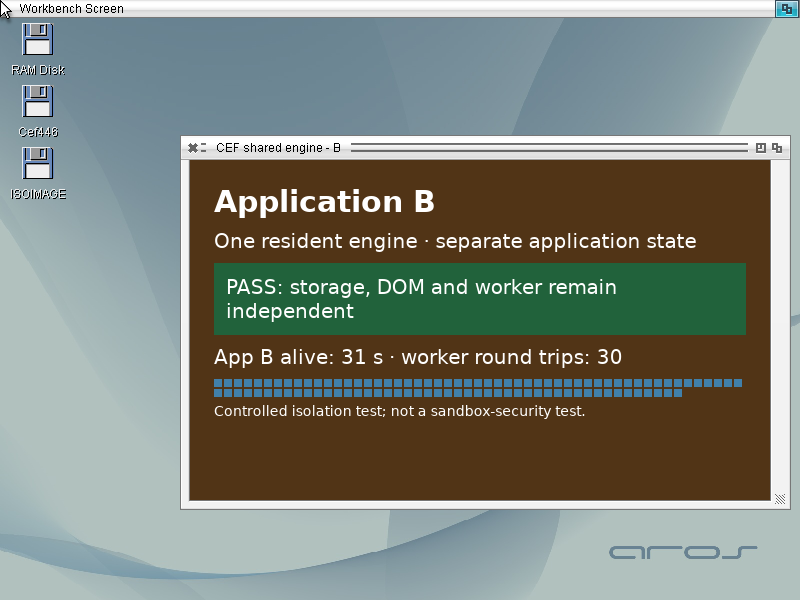

# Drain owner-local worker shutdown before renderer retirement

Source444 / native445 retains the owner renderer's task pump while asynchronous
worker shutdown posts its final proxy destruction back to the parent. It waits
at most ten seconds before preserving the existing deferred-retirement guard.
It does not force isolate destruction with live workers or alter the SDK.
Both x86_64 and AArch64 native links pass; all21 repository patches replay.

Sibling446 passes storage, DOM and worker-state isolation, app B survival after
app A closes, four native child entry/exit pairs, and both renderer retirements.
Both worker counts reach zero after the drain; neither retirement is deferred.
No native fault or timeout occurs. This is controlled QEMU application-state
isolation, not a security sandbox test.

Preceding source442/native443 results remain in ../retirement447. Their thirty-cycle
memory growth is36.71MiB, so no plateau is claimed. The retained post-host allocator
comparison449 shows Exec-backed page allocations falling from440.5MiB on426 to
129MiB on443. Those snapshots cannot be treated as445 measurements.

Hundred-cycle450 and fresh ARM448 visual/memory validation are pending. Browser
Vulkan, Widevine, physical hardware, and Node/Electron/Zune consumers retain their
separate qualification requirements. No RC binary is published.
